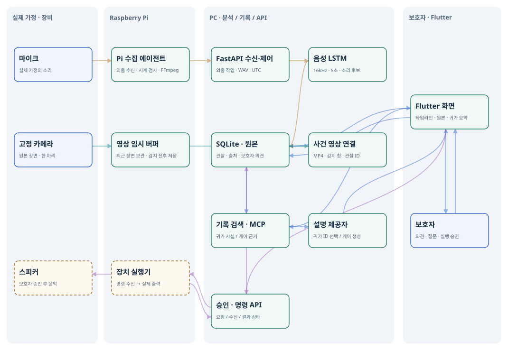

# PetMind

반려견의 소리를 기록하고, 보호자가 확인하고, 과거 기록으로 설명하는 시스템입니다. 처음 보신다면 아래 **동작 애니메이션**이 전체 흐름을 8단계로 보여줍니다.


- 재생·일시정지·단계 이동이 되는 버전: [PetMind_동작_애니메이션.html](PetMind_동작_애니메이션.html) (파일을 내려받아 브라우저에서 열면 됩니다. GitHub 파일 화면에서는 HTML 스크립트가 실행되지 않습니다.)
- 애니메이션은 이 README 0~4장을 근거로 만들었고, `python scripts/build_flow_animation.py`로 다시 생성합니다.

> **범위 변경 (2026-10-13):** 교수님과 상의해 **Raspberry Pi 5는 사용하지 않기로 했다.** 소리·영상 입력은 PC의 마이크·웹캠(FFmpeg)과 파일 재생으로 한다. 아래의 Pi 관련 서술(2장 표, 7장, SSH 터널, `pi_*` 스크립트)은 이전 계획에서 구현·시험한 선택 사항으로 남겨 두며 현재 시연 경로가 아니다.
>
> **음성 모델 확정:** 음성 감지는 **YAMNet**을 쓴다(PC에서 로컬 실행). 이 문서의 "음성 LSTM" 서술 중 운영 모델을 가리키는 부분은 YAMNet 채택 이전 기준이며, 코드 기본값도 `PETMIND_AUDIO_DETECTOR=yamnet`이다. LSTM 경로는 `PETMIND_AUDIO_DETECTOR=lstm`으로 켤 수 있는 비교 기준으로 코드에 남아 있다. YAMNet 분석 서비스는 `petmind/yamnet_service/`다.

### 시연 한 번에 켜기 (Windows 노트북)

```powershell
.\scripts\start_demo.ps1 -Capture   # 수집 에이전트까지 켠다: 화면에서 '자동 관찰'로 외출을 시작하면 노트북 웹캠·마이크로 수집
.\scripts\start_demo.ps1 -Seed      # 처음: 웹 빌드 → 서비스 3개 시작 → 공개 음원으로 시연 데이터 채우기 → 브라우저 열기
.\scripts\start_demo.ps1            # 다시 시작(데이터 유지)
.\scripts\start_demo.ps1 -Rebuild   # petmind_app/lib을 고친 뒤 웹 다시 빌드
.\scripts\start_demo.ps1 -Stop      # 모두 끄기
```

화면은 http://localhost:8021/, 데이터는 `artifacts/demo/`(git 제외)에 저장된다. 웹 빌드는 한글 경로 문제를 피하려고 `C:\petmind_build`에서 자동으로 한다(`PETMIND_BUILD_ROOT`로 변경). 외부로 나가는 요청은 없고 설명 제공자는 규칙 방식이다. 시연 데이터는 실제 반려견 기록이 아니라 공개 음원(ESC-50)과 시연 담당자 의견이다. 마이크·웹캠 수집은 아래 3)번 명령을 같은 백엔드(8010)에 대해 실행한다. 2026-10-22 이 노트북에서 시작, 시연 데이터 채우기, 정지, 데이터를 유지한 재시작을 확인했다. `-Capture`는 장치(웹캠·마이크 배열)를 자동 선택해(`scripts/make_capture_input.py`) 화면에서 시작한 자동 관찰 외출이 수집 요청 → 에이전트 → 5초 구간 분석·저장(약 45초에 관찰 10개)으로 이어지고 카메라 미리보기(640×480)가 나오는 것까지 확인했다. 헤드셋 마이크 등 다른 장치를 쓰려면 `python -m scripts.make_capture_input --audio <이름 일부>`로 입력 파일을 다시 만든다.

### 빠른 실행 — 노트북 하나로 (YAMNet, 2026-10-22 확인)

`.venv`에는 `requirements-runtime.txt`(백엔드·수집·FFmpeg 포함)를, YAMNet 서비스 환경(TensorFlow 포함)에는 `requirements-yamnet-experiment.txt`를 설치한다. 저장소 루트에서 서로 다른 터미널 세 개를 쓴다.

```powershell
# 1) YAMNet 분석 서비스 (TensorFlow 환경)
py -3.12 -m petmind.yamnet_service.app --port 8030

# 2) 백엔드 (.venv). 데이터는 git에서 제외되는 artifacts/live/에 둔다
$env:PETMIND_DATABASE_URL='sqlite:///artifacts/live/petmind_live.db'
$env:PETMIND_AUDIO_STORAGE_DIR='artifacts/live/user_audio'
$env:PETMIND_AUDIO_DETECTOR='yamnet'; $env:PETMIND_LLM_PROVIDER='rule'; $env:PETMIND_SEMANTIC_SEARCH='off'
.\.venv\Scripts\python.exe -m uvicorn petmind.backend.main:app --host 127.0.0.1 --port 8010

# 3) 노트북 웹캠·마이크 수집 (아래 capture-input.json 예시 참고)
.\.venv\Scripts\python.exe -m scripts.monitor_audio_events --input-args-file capture-input.json --audio-map 1:a:0 --video-map 0:v:0 --ffmpeg <ffmpeg 경로> --base http://127.0.0.1:8010 --pet-id my-dog --new-outing --store-consent
```

보호자 화면(Flutter 웹)은 Flutter 3.32.4(Dart 3.8.1)로 빌드해 정적 서버로 연다. **Windows에서 프로젝트 경로에 한글이 있으면 `flutter build web`이 셰이더 컴파일 단계에서 실패한다.** `petmind_app`을 ASCII 경로(예: `C:\petmind_build\petmind_app`)에 복사해서 빌드한다.

```powershell
cd C:\petmind_build\petmind_app
flutter pub get
flutter build web --release --no-web-resources-cdn --output=C:\petmind_build\web --dart-define=PETMIND_API_BASE=http://localhost:8010
py -3.12 -m http.server 8021 --bind 127.0.0.1 --directory C:\petmind_build\web   # 브라우저: http://localhost:8021/
```

이 PC에서 확인한 것: `/health`의 `audio_detector`가 `yamnet`이고, 공개 개 짖음 WAV의 Bark 점수 0.842·0.299, 문 두드리는 소리 0.00001, 빗소리 0.0이 저장됐다. 웹캠·마이크 수집은 5초 구간 단위로 분석·저장되고 `model_ready`가 `true`로 보고됐다. 개 짖음이 들어 있는 A/V 파일을 재생하면 앞뒤 5초가 붙은 사건 영상이 만들어졌다. 내장 마이크는 처음에는 음량이 0(무음)이었고(Windows 마이크 권한·음소거 확인 필요) 이후 주변 소리가 들어왔다. 헤드셋(G435) 마이크는 장치로는 보이지만 -91 dB의 무음이었다. **노트북 스피커로 재생한 개 짖음이 마이크로 되돌아오는 시험은 소리가 헤드셋으로 나간 것으로 보여 실패했고, 실제 소리로 짖음을 잡은 시험은 아직 하지 않았다.** 5분 연속 수집(웹캠 + 내장 마이크, 5초 구간 60개)에서 ffmpeg 메모리 약 82 MB, 임시 폴더 약 5 MB로 일정했고 정상 종료됐다. 종료 시 마지막 구간 파일에 오디오 스트림이 없어 수집 전체가 예외로 끝나는 문제가 두 번 났고, 불완전한 구간 하나만 건너뛰고(`segment_skipped` 로그) 구간별 고유 파일명을 쓰며 FFmpeg를 한 번 재시도하도록 고쳤다. 수정 뒤 5분 수집은 오류 없이 끝났지만 건너뛰기 경로 자체는 아직 실제로 발생하지 않아 검증하지 못했다. `torch`가 없는 환경에서는 학습·LSTM 비교용 테스트(`tests/test_audio_lstm.py` 등 6개)만 실행되지 않는다. `pytest tests petmind/backend/tests`는 157개 통과·10개 건너뜀(torch가 없으면 학습용 테스트를 건너뛴다)이고 Flutter 테스트 25개도 통과하며 `flutter analyze`도 문제가 없다.

---

## 목차

0. [한눈에 보기](#0-한눈에-보기)
1. [블록도](#1-블록도)
2. [하드웨어·네트워크](#2-하드웨어네트워크)
3. [소프트웨어·버전](#3-소프트웨어버전)
4. [AI 분석: 음성 LSTM·기록 RAG](#4-ai-분석-음성-lstm기록-rag)
5. [저장소 구조](#5-저장소-구조)
6. [설치 — Windows PC](#6-설치--windows-pc)
7. [설치 — Raspberry Pi 가상 장치 (선택)](#7-설치--raspberry-pi-가상-장치-선택)
8. [사용법 (매일 하는 순서)](#8-사용법-매일-하는-순서)
9. [API·MCP·명령 인터페이스](#9-apimcp명령-인터페이스)
10. [설정값과 선택 이유](#10-설정값과-선택-이유)
11. [검증 결과](#11-검증-결과)
12. [문제 해결 (확인한 증상)](#12-문제-해결-확인한-증상)
13. [남은 일](#13-남은-일)
14. [부록: 명령 모음](#14-부록-명령-모음)

---

## 0. 한눈에 보기

### 해결하려는 문제

반려견의 영상 움직임과 소리만 보고 감정·질환을 단정하기 어렵다. PetMind는 관찰 신호를 **반려견별 기록**으로 남기고, 과거 관찰·보호자 의견을 검색 근거로 제시해 보호자가 케어 제안을 검토하도록 돕는다. 음악 실행은 보호자 승인 후에만 요청한다. **급식기는 현재 범위에서 제외**한다.

### 지금 되는 것 (2026-10-12)

| 단계 | 현재 상태 | 검증 범위 |
|---|---|---|
| 관찰 | 합성 시나리오·준비된 공개 음원/영상 입력을 SQLite에 저장 | 실제 HTTP 흐름 확인 |
| 카메라 근거 | FFmpeg 최근 구간 버퍼 → 음성 LSTM 감지 전후 MP4 저장·관찰 연결·재생 | 30초 파일 입력과 실제 체크포인트로 15초 사건 영상 생성·브라우저 재생 확인; 실장비 미검증 |
| 음성 | WAV 에너지 후보와 **YAMNet Bark 점수**(채택), 보호자 확인. 이전 log-mel LSTM은 비교 기준으로 보존 | 공개 음원 182개 비교에서 YAMNet 단독 F1 0.795, 기존 LSTM 0.429; 1초 미만 짖음은 많이 놓침 |
| 외출·귀가 | 세션별 관찰·근거 재생·귀가/하루 요약·과거 세션 비교 | 영상 세션 브라우저 흐름과 원본 7~12초 재생 확인 |
| 사용자 음원 | 별도 저장/학습 동의·확인 의견·추천 큐·만료/삭제·참여 철회 | 로컬 단일 가정 시제품; 실제 개인화 정확도 미검증 |
| 개별 기록 RAG | 같은 반려견의 과거 기록을 MCP로 검색, 기간·근거 ID 저장 | 실제 Gemini·임베딩 호출 및 합성 사례 확인 |
| 화면 | Flutter에서 관찰·근거·제안·승인·이력·프로필·피드백 표시 | Flutter 테스트·웹 빌드; 짧은 연속 자동 조작 영상 확보 |
| 실행 | 승인된 음악 명령의 요청·수신·완료·실패·시간초과 | PC와 실제 Pi에서 **가상 명령** 왕복; 스피커/GPIO 미사용 |

### 발표 자료

- [3주차 발표 PPT](docs/presentation/PetMind_3주차발표자료.pptx), [슬라이드별 설명 원고](docs/presentation/PetMind_설명.docx), [실장비 기준 HTML 블록도](docs/presentation/PetMind_블록도.html)를 함께 제공한다.
- 웹 시연 영상은 발표 중 별도로 재생한다. 원본 음원·영상과 시연 녹화 파일은 Git에 포함하지 않는다. 재현 절차와 입력 출처는 [사례별 시연](docs/43_자연스러운_음성_사례별_UI_RAG_시연.md), [방문 상황 시연](docs/44_방문_상황_음원_RAG_시연.md)에 기록했다.

### 하루 사용 3줄 요약

```powershell
# 저장소 루트, 각각 별도 터미널: 백엔드 → 가상 장치 → 화면
.\.venv\Scripts\python.exe -m uvicorn petmind.backend.main:app --host 127.0.0.1 --port 8010
.\.venv\Scripts\python.exe -m petmind.device_agent
cd petmind_app; flutter run -d chrome --web-port 8021
```

최초 설치와 `.env`는 6장을 따른다. 준비된 모델·공개 입력이 없으면 해당 화면은 미준비 상태가 정상이다.

---

## 1. 블록도

### 1-1. 구성 — 음성 감지와 근거 영상

WAV 업로드·분석·의견·RAG에 더해 **동일 입력의 음성 LSTM 감지 → 전후 영상 저장 → 관찰 연결·재생**을 구현했다. FFmpeg 장치 입력 어댑터도 제공하지만 실제 PC 마이크·웹캠 연결은 아직 검증하지 않았다(Raspberry Pi는 사용하지 않기로 결정). 파일 재생은 `file_replay`, 장치 입력은 `device`로 구분한다.



위 그림은 [전체·모듈별 HTML/SVG 블록도](docs/PetMind_실장비_블록도.html)의 전체도를 그대로 내보낸 정적 SVG다. 모듈별 설명과 신호 흐름 재생은 HTML 파일을 내려받아 브라우저에서 연다. GitHub 파일 화면에서는 HTML의 스크립트가 실행되지 않는다. HTML을 변경한 뒤에는 `node scripts/export_architecture_svg.js`로 README 그림을 다시 만든다. 음악 명령 왕복은 현재 가상 실행이며 물리 재생은 추가 연동 대상이다.

**아키텍처 경계:** 자동 외출은 서버의 수집 요청을 Pi가 가져오는 방식이다. 요청 수락과 heartbeat 응답의 서버 시각을 Pi 시각과 비교해 왕복 지연 또는 추정 오차가 2초를 넘으면 수집을 시작하지 않거나 중지하고 `clock_mismatch`로 기록한다. 이 검사는 시각이 잘못된 관찰 생성을 줄이지만 실장비의 음성·영상 오차 측정을 대신하지 않는다. 단절된 수집 작업은 다른 장치가 자동으로 빼앗지 않으며, 장시간 단절 후에는 외출을 종료하고 새 외출을 시작한다. 이때의 미분석 시간은 조용했던 시간이 아니라 관찰 공백이다.

귀가 요약과 RAG는 **음성 모델의 개 짖음 소리 후보 창 수**를 우선 표시한다. 에너지 감지기의 큰 소리 변화 횟수는 짖음 판별이 아니며 진단용 원시 분석에만 보존한다. 모델 판별이 실패하면 짖음 여부를 판단할 수 없다고 표시한다. 모델의 5초 창은 실제 짖음 횟수나 발성 경계가 아니다. 카메라 화면은 수집 프로그램이 같은 FFmpeg 프로세스의 두 번째 출력(최대 30fps, 640px JPEG)을 MJPEG 스트림으로 `127.0.0.1:18081/stream`에 내보내고, 백엔드의 `/camera/stream`이 이를 그대로 전달한다. 프레임은 메모리에만 두며 저장하지 않는다. 이 노트북에서 브라우저가 받는 속도는 22초 동안 **평균 29.9fps(프레임 간격 중앙값 32ms, 최대 118ms)**였다(2026-10-23). 이 값을 내려면 웹캠 입력을 640×480 MJPEG 30fps로 지정하고(`scripts/make_capture_input.py`가 장치 모드를 조회해 자동 선택; 지정하지 않으면 HD 무압축 10fps로 열릴 수 있다) DirectShow 마이크 버퍼를 50ms로 줄여야 한다(기본 500ms는 영상까지 0.5초 단위로 뭉쳐 내보낸다). 처음 방식(5초 구간의 마지막 프레임)은 약 5초, 파일 갱신 방식은 초당 2~6장이었다. 수집이 멈추면 스트림은 끊기고 화면은 마지막 프레임에 머문다. 녹화가 아니다. 귀가 설명은 서버가 계산한 사실 중 Gemini가 근거 ID를 선택하고 서버가 문장을 렌더링한다. 케어 제안은 검색된 기록을 바탕으로 Gemini가 문장을 생성하므로 인용 ID만으로 모든 문장의 사실성이 입증되지는 않는다.

`RAG·케어` 화면에는 원본 구간 확인, 당시 자극 기록, 환경 조정 등 **보호자가 해볼 일**을 별도로 표시한다. 음성 후보와 사람의 반려견 소리 확인 의견이 함께 있을 때만 보호자 승인형 **가상 음악 실행**을 제안한다. 의견이 불확실하면 음악은 짖음 확인 뒤 시도할 수 있는 조건부 안내로만 표시하며, 모델 점수만으로 행동·감정이나 음악 효과를 단정하지 않는다.

### 감지 기반 영상 저장 — 구현 내용과 실행

- `scripts.monitor_audio_events`가 동일 입력의 영상·음성을 약 5초 MP4로 임시 저장하고, WAV를 추출해 기존 음성 LSTM API로 보낸다. 영상 행동 모델은 호출하지 않는다.
- 서버 LSTM 임계값을 넘은 분석 창에 앞뒤 각 5초를 붙인다. `--pre-s`, `--post-s`로 0~15초를 설정한다. 에너지 후보만 있거나 모델이 없으면 사건 영상을 만들지 않는다. 감지 창은 정확한 발성 경계가 아니다.
- 겹치는 사건을 합치고 이후 감지의 앞부분까지 확인한 뒤 확정한다. 긴 연속 감지는 `--max-event-s`(기본 60초) 단위로 나눈다. 오래된 임시 구간은 삭제하고 `--max-buffer-mb`(기본 128MB) 초과 확인 시 수집을 중단한다.
- 관찰 ID·수집 세션·UTC 시각을 저장한다. 누락·부족 구간, 모델 미준비, 영상 생성 실패를 표시한다. 저장된 음성은 영상 실패와 관계없이 유지하며, 음원 삭제·만료 시 연결 사건 영상도 사용할 수 없게 하고 제거한다.
- 영상 재생 길이는 음성 분석 표본 시간에 더하지 않는다. 화면과 RAG는 영상 상태·원본 근거·보호자 의견을 표시하고 카메라를 자동 행동 판단으로 해석하지 않는다.

기존 백엔드를 먼저 실행하고, **소리 트랙이 있는 MP4와 FFmpeg(libx264/AAC 지원)**를 준비한다. 아래 `ffmpeg`는 PATH에 설치된 실행 파일이며 `--ffmpeg`에 절대 경로를 지정해도 된다.

```powershell
python -m scripts.monitor_audio_events --input "C:\data\dog_camera.mp4" --ffmpeg ffmpeg --base http://127.0.0.1:8010 --pet-id my-dog --new-outing --store-consent
```

파일은 원래 속도로 재생하며 자동 생성한 외출은 종료 시 닫는다. 기존 외출에 연결하려면 `--new-outing` 대신 `--outing-id ID`를 쓴다. 파일 재생은 `uploaded_audio`, 장치 수집은 `live` 외출이어야 한다. 공개 자료는 `--demo-source "자료명·출처"`를 반드시 지정해 개인 관찰과 구분한다. 학습 동의는 자동으로 켜지지 않는다. 실행 후 같은 반려견의 외출 화면에서 **중요한 순간 → 구간 보기**로 연다.

Pi/Linux 장치 입력 예: 먼저 [SSH 터널](docs/AUTOMATIC_OUTING.md)을 열고, 로컬 `capture-input.json`에 실제 장치 이름에 맞는 FFmpeg 입력 인자를 저장한다. 이 예시는 해당 장치 존재나 드라이버 정상 동작을 보증하지 않는다. 아래 단독 스크립트는 자동 외출 에이전트의 시계 사전 검사를 거치지 않으므로 장비 시각을 별도로 확인한다.

```json
["-f", "v4l2", "-i", "/dev/video0", "-f", "alsa", "-i", "default"]
```

```bash
python -m scripts.monitor_audio_events --input-args-file capture-input.json --audio-map 1:a:0 --video-map 0:v:0 --ffmpeg ffmpeg --base http://127.0.0.1:18010 --pet-id my-dog --new-outing --store-consent
```

**Windows PC 입력 예(Raspberry Pi를 쓰지 않기로 한 뒤의 기본 경로):** `ffmpeg -list_devices true -f dshow -i dummy`로 장치 이름을 확인한 뒤 `capture-input.json`에 저장한다. 서버에 직접 접속하므로 SSH 터널은 필요 없다. 장치 이름은 PC마다 다르며 아래는 예시일 뿐 동작을 보증하지 않는다.

```json
["-f", "dshow", "-i", "video=720p HD Camera", "-f", "dshow", "-i", "audio=마이크 배열(디지털 마이크용 인텔® 스마트 사운드 기술)"]
```

```powershell
python -m scripts.monitor_audio_events --input-args-file capture-input.json --audio-map 1:a:0 --video-map 0:v:0 --ffmpeg ffmpeg --base http://127.0.0.1:8010 --pet-id my-dog --new-outing --store-consent
```

(이전 계획) Pi에는 수집 스크립트와 `requests`, `soundfile` 및 FFmpeg가 필요하고 모델 추론은 PC API에서 수행한다. 현재 API는 비로컬 접속과 외부 웹 Origin을 403으로 거부한다. PC 서버는 `127.0.0.1`에 두고 Pi는 [SSH 역방향 터널](docs/AUTOMATIC_OUTING.md)로 연결한다. `pet_id`와 Pi 작업 소유 토큰은 사용자·장치 인증이 아니므로 인터넷 또는 공용 LAN에 공개해서는 안 된다. 수집 시각은 프로세스 시작 UTC와 미디어 상대 시각으로 계산하고, 자동 외출 에이전트는 서버 시각을 왕복 지연과 함께 검사한다. 파일 재생·수동 장치 스크립트는 이 사전 검사를 거치지 않으며 장치 지연·실제 시각 오차는 현장에서 확인해야 한다.

**확인한 결과:** 30초 테스트 입력에서 6개 음성 관찰(실제 디코딩 표본 30.024초), 감지 사건 1개, 15초 MP4 저장과 브라우저 끝까지 재생을 확인했다. 공개 ESC-50 음원에 생성한 테스트 패턴을 붙인 **기능 검증 자료**로, 실제 반려견 영상이나 감지 정확도 평가가 아니다. [검증 기록](docs/evidence/event_video_integration.json)에는 근거 ID·출처·의견을 포함한 규칙 기반 RAG 응답을 저장했다. 이번 기능은 새로운 Gemini 응답 품질 측정이나 모델 재학습이 아니다.

**남은 장비 검증:** 실제 카메라·마이크 연결, 소리와 장면의 오차 측정, 장시간 동작·재부팅 복구. 현재 수집기는 장치/서버 오류에 실패를 기록하고 중단하는 방식이며 자동 재연결·오프라인 재전송은 후속 작업이다. 원본 버퍼는 종료 시 정리된다. 모델 누락이나 낮은 감지율 때문에 놓친 소리는 사건 영상으로 보존되지 않는다.

### 1-2. 현재 구현된 관찰·설명·가상 실행

1. `POST /demo/observe` 또는 `POST /media/observe`가 출처를 붙인 관찰을 저장한다.
2. `POST /care/evaluate`가 **같은 반려견·현재보다 과거인 기록**을 MCP로 조회하고, 검색 결과를 Gemini 또는 규칙 제공자에 전달한다.
3. 제안과 근거 ID가 DB에 남는다. 화면은 제공자가 Gemini인지 규칙/폴백인지 보여준다.
4. 음악을 승인하면 명령이 `requested`가 된다. 가상 장치가 `acknowledged` 후 `completed` 또는 `failed`를 보고한다. 무응답은 `timed_out`이다.

공개 영상과 WAV를 함께 시연할 때 두 파일은 **별도 출처**다. 실제 동시 녹화나 실제 반려견 감정 판정으로 해석하지 않는다.

음성 중심 경로는 **외출 시작 → WAV 업로드 → 보호자 확인 → 귀가/하루 요약 → 원본 근거 재생**이다. 개인 기록 저장과 공통 모델 학습 동의를 분리하며, 확인 추천·원본 보관 기간·삭제·학습 참여 철회를 제공한다. 검수된 자료만 학습 목록으로 내보내고 자동 재학습·자동 배포는 하지 않는다. 추가 센서는 현재 범위에 포함하지 않는다.

---

## 2. 하드웨어·네트워크

| 항목 | 현재 구성 | 범위 |
|---|---|---|
| 개발 PC | Windows 11, Python 3.12, Flutter 웹 | 백엔드 `127.0.0.1:8010`, 화면 `localhost:8021` |
| 저장소 DB | PC 로컬 SQLite `petmind.db` | Git에서 제외, 재시작 후 기록 유지 |
| PC 마이크·웹캠 | FFmpeg DirectShow 입력으로 수집(2026-10-13 이후 기본 경로) | 개발 PC에서 FFmpeg가 장치를 인식하는 것까지 확인. 수집·드라이버·음성/영상 시각 차이는 미검증 |
| Raspberry Pi | `/home/pi/Desktop/PetMind_Test`, Python 3.13.5 | **사용하지 않기로 결정(2026-10-13).** 이전에 SSH 역방향 터널로 **가상 장치 명령** 왕복 확인 |
| 외부 서비스 | Gemini 생성·임베딩 API | 로컬 `.env`의 키가 있을 때 사용; 실패 시 폴백 표시 |
| 카메라·마이크·스피커 | FFmpeg 장치 입력·사건 녹화 코드 제공; 물리 재생 미연결 | 파일 입력 검증 완료, 실제 장비·드라이버 검증은 남음 |

Pi 시험은 필수 실행 경로가 아니다. SSH 별칭 `raspberrypi-ai`는 시험 환경의 설정이며 다른 PC에서는 자신의 호스트 설정이 필요하다.

---

## 3. 소프트웨어·버전

| 구분 | 현재 개발·검증 환경 | 역할 |
|---|---|---|
| Python | 3.12.10 | 분석·FastAPI·MCP·가상 장치·평가 |
| FastAPI / SQLAlchemy / SQLite | 버전 범위는 `requirements-core.txt` | HTTP API·기록 보존 |
| PyTorch / Ultralytics / OpenCV | 버전 범위는 `requirements-vision.txt` | 음성 LSTM; 이전 영상 실험 의존성도 남아 있음 |
| 공식 MCP Python SDK | `mcp==2.3.0` | 별도 stdio 프로세스의 읽기 전용 도구 |
| Flutter / Dart | 3.47.5 / 3.13.4 | 보호자 웹 화면 |
| Raspberry Pi 시험 환경 | Debian 13.5, Python 3.13.5 | `requests` 기반 가상 장치 |

이번 Windows 환경에서 해결된 전체 Python 의존성 버전은 `requirements-lock.txt`에 기록했다. 다른 운영체제의 완전 재현성까지 보장하는 잠금 파일은 아니다.

---

## 4. AI 분석: 음성 LSTM·기록 RAG

| 역할 | 현재 방식 | 판단에 필요한 한계 |
|---|---|---|
| 카메라 원본 확인 | 음성 감지 전후 MP4 저장·관찰 연결·구간 재생 | 보호자 확인용이며 영상 자동 행동 분석은 현재 범위에서 제외 |
| 음성 | 에너지 후보와 YAMNet Bark 점수(5초 창)를 별도로 제공. 이전 16kHz·5초 log-mel LSTM은 비교 기준 | LSTM의 FSD 외부 재현율 28.3%, YAMNet은 [docs/45~47](docs/45_YAMNet_임베딩_LSTM_비교.md); 개체·감정·질환 판정 아님 |
| 기록 검색 | 반려견·기간 필터, 기존 케어 의미 검색, 세션 질문 의도별 근거 검색 | 세션 검색과 기존 임베딩 검색의 평가를 구분 |
| 귀가/하루 설명 | 코드로 중복 제외 집계 → 사실 검색 → Gemini 근거 ID 선택 또는 템플릿 | 수치·문장은 서버가 렌더링, 필수 근거 누락 시 폴백 |
| 제안 생성 | 검색·통계·케어 이력을 Gemini에 전달, 유효하지 않은 인용·호출 실패 시 규칙 폴백 | 케어 효과·의학적 판단을 검증한 시스템이 아님 |

이전 영상 LSTM·탐지·추적 실험 코드와 결과는 재현을 위해 보존하지만 현재 개발·발표의 핵심 기능에는 포함하지 않는다. 과거 결과는 [실제 데이터 평가](docs/25_실제데이터_성능비교.md)에서 확인할 수 있다. 현재 LSTM 개선 대상은 **음성의 개 짖음 소리 후보 감지**다.

RAG는 같은 반려견의 과거 기록을 시간으로 먼저 제한하고 관련 기록을 선택해 **기록 ID를 인용**한다. 외출/하루 설명은 코드 집계→사실 검색→Gemini의 근거 ID 선택→서버 문장 렌더링 경로이고, 케어 제안은 기간·의미 검색→Gemini 문장 생성 경로다. 케어 제안은 인용 ID의 범위를 검사하지만 문장별 수치·인과관계 검증은 아직 남았다. 자체 작성 20개 질문의 Recall@5는 개선됐지만 실제 보호자 질문 성능은 별도 평가가 필요하다. [RAG 평가와 폴백 기록](docs/24_RAG_기간_의미검색_개선.md), [최근 실제 검증](docs/RAG_검증과_개선_2026-10-12.md)을 참고한다.

**API 키:** `.env.example`을 복사한 로컬 `.env`에 `GEMINI_API_KEY`를 설정한다. 키는 Git·문서·채팅에 넣지 않는다. 키가 없으면 규칙 제공자로 시연할 수 있다. Gemini 호출·검증 실패 시에는 폴백 사유가 표시된다.

---

## 5. 저장소 구조

음성 실험·사용자 데이터 흐름은 [파트 33](docs/33_음성중심_개발진행.md), 최근 검색·집계·모델 캐시 최적화는 [파트 35](docs/35_프로세스_정확성_최적화.md)에 기록했다. CLAP은 비교 실험에만 사용하며 사전학습 중복 가능성 때문에 운영 모델로 채택하지 않았다. FSD 자료 추가 학습도 LSTM 검증 성능이 개선되지 않아 기존 모델을 유지했다.

추가 [YAMNet 임베딩→LSTM 비교 실험](docs/45_YAMNet_임베딩_LSTM_비교.md)에서는 명시적 FSD50K Bark 라벨과 비개 소리 182개를 사후 평가했다. YAMNet 단독 F1 **0.795**, 시간순 임베딩 LSTM F1 **0.789**, 기존 LSTM F1 **0.429**였다. 평가 자료의 이전 열람 및 YAMNet 사전학습 중복 가능성이 있어 독립 정확도로 주장하지 않으며, 운영 모델은 교체하지 않았다.

[AudioSet 구간 정답 실험](docs/46_AudioSet_구간정답_YAMNet_LSTM_재학습.md)에서는 접근 가능한 학습 음원 64개로 시간순 YAMNet 특징을 LSTM에 추가 학습했다. 이후 [별도 AudioSet eval 53개 음원의 5초 창 106개 평가](docs/47_AudioSet_시간구간_짖음_평가.md)에서 고정한 YAMNet 단독 F1은 **0.816**, 기존 임베딩 LSTM은 **0.674**, 추가 학습 LSTM 세 후보는 **0.778 / 0.739 / 0.720**이었다. YAMNet 단독은 짖음이 1초 미만 겹치는 23개 창 중 12개를 놓쳤다. 약 1초 특징 구간으로 학습한 LSTM도 같은 10초 연속 입력 조건에서 F1 **0.783**으로 YAMNet 단독 **0.800**보다 낮고 오탐이 많아 채택하지 않았다. AudioSet은 YAMNet 사전학습 자료이며 접근 가능한 영상만 모은 편향도 있으므로 이 수치는 독립적인 가정 환경 정확도가 아니다. **실험 후보는 운영 모델로 자동 교체하지 않았다.**

같은 WAV로 판별부터 귀가 요약·기록 검색·케어까지 비교하도록 [YAMNet 전체 흐름 시험 사이트](experimental/yamnet_full_site/README.md)를 별도 웹 `8022`·API `8011`·DB로 제공한다. YAMNet 분석 서비스 `8030`에는 [점수만 확인하는 진단 화면](petmind/yamnet_service/README.md)도 있다. 기존 LSTM 사이트와 기록은 유지한다. 비교 사이트는 기본적으로 로컬 MCP 기록 검색·규칙 제안으로 실행하며, 사용자가 승인한 파생 관찰 정보로 Gemini 생성 답변과 근거 선택도 실측했다. 원본 WAV는 Gemini에 전송하지 않았다.

RAG 시연은 합성 사례의 원본 음원 구간·모델 창 수·시연 담당자 의견을 각각 근거로 보여준다. Gemini는 기록에서 사실 ID를 고르고 서버가 수치와 문장을 검증해 표시하며, 근거가 맞지 않으면 규칙 제공자로 전환한다. 방문 상황의 초인종·노크 설명은 **업로드 담당자가 입력한 문장**이다. 음성 모델이 방문자나 짖음 원인을 판별한 결과가 아니다. [사례별 UI·케어 검증](docs/43_자연스러운_음성_사례별_UI_RAG_시연.md)과 [방문 상황 RAG 검증](docs/44_방문_상황_음원_RAG_시연.md)에 실제 화면 조작·출처·한계를 적었다.

```text
capstone/
├── README.md                 이 문서: 설치·사용·검증·문제 해결
├── AGENTS.md                 개발 범위와 검증 원칙
├── .env.example              비밀값 없는 설정 예시
├── requirements-*.txt        Python 의존성 (core / vision / Windows lock)
├── pet_monitor/              음성 LSTM·분석 및 보존된 이전 영상 실험
├── petmind/
│   ├── backend/              FastAPI·SQLite·MCP·Gemini/규칙 제공자
│   └── device_agent.py       PC/Pi 호환 가상 음악 장치
├── petmind_app/              Flutter 보호자 화면
├── scripts/                  학습·공개 입력 준비·평가·통합 검증
├── tests/                    분석·추적·LSTM 회귀 테스트
├── docs/                     작업 기록·평가 근거
│   ├── evidence/            공개 가능한 요약 JSON·그림·렌더링 캡처
│   └── presentation/        발표 PPT·설명 원고·HTML 블록도
└── legacy/                   이전 시제품·초기 문서 (현재 실행 경로 아님)
```

**저장소 밖/무시되는 로컬 파일:** `.env`, `petmind.db`, `device_commands.db`, `artifacts/`의 원본 데이터·모델·평가 산출물, Flutter 빌드 결과. 이전 급식·센서 시제품은 [`legacy/`](legacy/README.md)에서만 참고한다.

---

## 6. 설치 — Windows PC

### 6-1. 준비·복제

Python **3.12**, Git, Flutter를 설치하고 `flutter --version`으로 Flutter 명령이 실행되는지 확인한다.

```powershell
git clone https://github.com/kuro-0211/capstone.git
cd capstone
py -3.12 -m venv .venv
.\.venv\Scripts\python.exe -m pip install -r requirements-vision.txt
flutter --version
```

`py -3.12`가 없다면 해당 Python 실행 파일로 가상 환경을 만든다. 영상·학습 없이 합성 관찰/API만 시험할 때는 `requirements-core.txt`를 대신 설치할 수 있다.

### 6-2. 선택 설정

```powershell
Copy-Item .env.example .env
# Gemini를 쓸 때만 .env의 GEMINI_API_KEY에 본인 키를 입력하고 백엔드를 재시작
```

키가 없는 기본 시연은 규칙 제공자를 사용한다. 예제의 의미 검색 설정은 키가 없으면 키워드로 폴백한다. 실제 Gemini 경로는 키 설정 후 `scripts.verify_gemini`로 확인한다.

### 6-3. 공개 입력·모델 준비 (선택)

> 이 절은 보존된 이전 파일·영상 실험의 재현 절차다. 현재 음성 중심 시연에는 6-4와 8장의 음원 시연을 사용하며 영상 행동 모델 준비는 필수가 아니다.


```powershell
.\.venv\Scripts\python.exe -m scripts.train_lstm
.\.venv\Scripts\python.exe -m scripts.prepare_media
.\.venv\Scripts\python.exe -m scripts.evaluate_audio
.\.venv\Scripts\python.exe -m scripts.prepare_davis
.\.venv\Scripts\python.exe -m scripts.evaluate_video
```

DAVIS 공식 이미지 자료는 약 **833MB**다. 출처·조건·해시는 [`docs/evidence/public_inputs.json`](docs/evidence/public_inputs.json)에 기록했다. 모델과 원본 파일은 `artifacts/`에 생성되며 GitHub에는 포함하지 않는다. 합성 시연만 할 때는 이 단계를 건너뛸 수 있다.

---

### 6-4. 음성 LSTM과 선택 비교 실험

```powershell
# 전체 ESC-50 확보 및 검증 분할 기반 학습 (시간·디스크 필요)
.\.venv\Scripts\python.exe -m scripts.prepare_esc50
.\.venv\Scripts\python.exe -m scripts.train_audio_baselines

# 선택: FSD 평가 자료와 기존 모델 비교
.\.venv\Scripts\python.exe -m scripts.prepare_fsd50k_subset --split eval --per-class 60
.\.venv\Scripts\python.exe -m scripts.evaluate_audio_external

# 선택: CLAP 비교용 추가 의존성·모델 다운로드
.\.venv\Scripts\python.exe -m pip install -r requirements-audio-experiments.txt
.\.venv\Scripts\python.exe -m scripts.evaluate_clap_audio --dataset fsd50k
```

음원 업로드는 `requirements-vision.txt` 환경에서 실행한다. `artifacts/audio_lstm/esc50_lstm.pt`가 없으면 모델 미준비를 표시한다. CLAP은 API 필수 의존성이 아니다. 기존 `requirements-lock.txt`는 이전 Windows 환경 기록으로 선택 실험 패키지까지 잠근 파일은 아니다.

브라우저 영상 시연은 `imageio-ffmpeg==0.6.0`을 선택 설치하고 `python -m scripts.prepare_browser_video`, `python -m scripts.evaluate_video --filename davis_dog_replay_5fps_h264.mp4 --report artifacts/video_analysis.json`을 순서대로 실행한다. 변환된 파일의 해시로 다시 분석하며 이전 결과를 붙이지 않는다.

## 7. 설치 — Raspberry Pi 가상 장치 (선택)

PC만으로 승인·가상 실행 흐름을 시연할 수 있다. Pi 왕복은 별도 실험이며 **실제 음악·GPIO 실행이 아니다**. 기존 Pi 테스트 폴더가 있는 환경에서 PC API를 실행한 뒤 SSH 역방향 터널을 연다.

```powershell
ssh -N -R 127.0.0.1:18010:127.0.0.1:8010 -o ExitOnForwardFailure=yes raspberrypi-ai
```

Pi의 `/home/pi/Desktop/PetMind_Test`에서 `sh run_once.sh` 또는 전용 `.venv`의 `device_agent.py`를 실행한다. 폴더 구성·재현 명령은 [Pi 실행 안내](scripts/PI_TEST_README.md)와 [왕복 기록](docs/20_Pi_바탕화면_왕복테스트.md)을 따른다. Pi 시험 중에는 PC 에이전트를 중지해 명령 처리 주체를 분리한다.

---

## 8. 사용법 (매일 하는 순서)

### 음원·외출 시연

공개 자료만으로 새 PC에서 입력·검토·귀가 흐름을 재현하려면 저장소 루트에서 `python -m scripts.prepare_demo_audio`를 실행한다. 고정된 ESC-50의 공식 분할 1·5에서 Dog 3개와 rain 1개를 내려받아 파일 해시·공식 메타데이터·WAV 형식을 확인하고 `artifacts/datasets/esc50_demo/audio/`에 둔다. 이 중 공식 5번 분할 Dog 2개는 저장된 기본 LSTM 평가에서 감지 1개·놓침 1개였고, 1번 분할 Dog 1개도 이전 시연에서 놓쳤다. 전체 2,000개 음원 다운로드나 모델 재학습은 필요하지 않다. **오디오 LSTM 점수 표시에는 별도 로컬 체크포인트가 필요**하다. `/health`의 `audio_lstm_checkpoint_present`로 파일 존재 여부를 먼저 확인한다. 이 값은 모델 정상 추론을 보증하지 않으며, 체크포인트가 없거나 추론에 실패하면 화면은 모델 미준비/실패를 명시하고 에너지 후보만 기록한다. 네 음원은 화면 시연 표본이며 새 독립 성능 평가 자료가 아니다. 실제 시연 순서는 [발표용 설명 영상·현장 시연 절차](docs/39_Genesis_브라우저_설명영상.md)에 정리했다.

1. 백엔드와 Flutter를 실행하고 반려견을 선택한다.
2. **사용자 음원** 모드에서 외출을 시작한다. 30초 이하·12MB 이하 WAV를 선택하고 개인 저장 동의를 체크한다. 공통 모델 학습 참여는 별도 선택이다.
3. 업로드 결과와 확인 추천을 열고 원본을 들은 뒤 보호자 의견·메모를 남긴다. 공개 자료를 실제 보호자 기록으로 소개하지 않는다.
4. **귀가 · 외출 종료 → 근거 기반 요약 → 근거 링크**를 확인한다. 음원만 입력한 기록의 영상 판단 불가는 정상이며 오디오 모델 실패를 뜻하지 않는다.
5. **하루 근거 설명**과 **지난 외출과 비교**를 확인한다. 같은 입력 방식의 과거 표본이 없으면 비교 불가다. 중복 원본 음원은 한 번만 집계하고 각각의 의견은 보존한다.
6. 팝업의 재생 버튼이 반응하지 않으면 **원본 플레이어 새 탭에서 열기**를 사용한다. 삭제·만료·유실된 원본은 재생 불가로 표시한다.

상세 시연·복구 절차는 [파트 34](docs/34_음성중심_시연_완료점검.md), 최신 브라우저 확인과 출처 표기는 [파트 38](docs/38_자체피드백_안정성_출처_사용성.md)을 따른다. 현재 `pet_id`는 인증이 아니므로 로컬 단일 가정 시제품으로만 실행한다. 외부 사용자 모집 전에는 인증·사용자별 접근 제어가 필요하다.

### 기존 케어 제안·가상 장치 시연

1. 저장소 루트에서 백엔드를 실행하고 `http://127.0.0.1:8010/health`가 `healthy`인지 확인한다.
2. 다른 터미널에서 가상 장치를 실행한다. Pi 시험이면 7장의 Pi 에이전트로 대체한다.
3. `petmind_app`에서 `flutter pub get` 후 `flutter run -d chrome --web-port 8021`로 화면을 연다.
4. 반려견을 선택하고 **합성 과거 기록 준비** → `calm`, `anxious`, `bored_pacing` 중 하나를 관찰한다. 관찰·근거·제안의 입력 출처를 확인한다.
5. 음악 제안이 있는 경우 보호자가 승인한다. 요청 → 장치 응답 → 완료/실패와 타임라인을 확인한다. 음악 제안이 없으면 승인할 명령도 없다.
6. 공개 음원·영상 시연은 6-3의 파일 준비 후 화면에서 선택한다. 서로 다른 원본을 조합한 **합성 시연**임을 함께 표시한다.

API 문서: `http://127.0.0.1:8010/docs`. Flutter의 기본 API 주소는 `http://localhost:8010`이며 다른 호스트에서 열 때 `--dart-define=PETMIND_API_BASE=http://서버주소:8010`으로 바꾼다. 현재 백엔드 CORS와 바인딩은 로컬 개발용이다. [Flutter 렌더링 캡처](docs/evidence/flutter_dashboard_render.png)는 실제 브라우저 클릭 녹화가 아니다.

---

## 9. API·MCP·명령 인터페이스

| 인터페이스 | 대표 경로·도구 | 용도 |
|---|---|---|
| 상태·관찰 | `GET /health`, `POST /observations`, `GET /observations` | DB/제공자 상태와 반려견별 관찰 |
| 시연 입력 | `POST /demo/seed`, `POST /demo/observe`, `GET /media/catalog`, `POST /media/observe` | 합성 이력·준비된 공개 입력 |
| 제안·승인 | `POST /care/evaluate`, `GET /care/history`, `POST /care/{id}/approve` | 근거 검색 후 제안, 보호자 승인 |
| 가상 장치 | `GET /care/actions/pending`, `POST /care/actions/{command_id}/ack` | 명령 조회·수신·완료/실패 보고 |
| 이력·추가 기록 | `GET /timeline`, `GET /metrics`, `/pets/{pet_id}/profile`, `/feedback` | 타임라인·수치·프로필·보호자 의견 |
| 외출·요약 | `POST /outings`, `POST /outings/{id}/end`, `GET /outings/{id}/summary`, `POST /outings/{id}/explain` | 시작·종료·집계·근거 설명 |
| 하루·근거 | `GET /outings/day`, `POST /outings/day/explain`, `GET /outings/observations/{id}/evidence`, `GET /outings/observations/{id}/clip` | 한국 시간 하루 요약·과거 인용 기록의 원본 가용성·구간 재생 |
| 사용자 음원 | `/audio-clips/upload`, `/audio-clips/review-queue`, `/audio-clips/{id}/review`, `/audio-clips/{id}/consent`, `/audio-clips/{id}/delete-original` | 동의·분석·의견·철회·삭제 |
| MCP stdio | `search_observations`, `get_observation_stats`, `get_care_history`, `get_outing_facts` | 같은 반려견의 기록·집계·세션 근거 읽기 |

`petmind/device_agent.py`는 2초 간격으로 대기 명령을 조회하고 명령 ID를 로컬 SQLite 캐시에 남긴다. 승인 전에는 장치 명령이 없다. 무응답 만료는 기본 30초다. 전체 요청·응답 계약은 `/docs`와 [`schemas.py`](petmind/backend/schemas.py)를 따른다.

---


### 사건 영상 API (추가)

| 인터페이스 | 용도 |
|---|---|
| `POST /audio-clips/upload` 선택 쿼리 `captured_at`, `capture_kind`, `capture_session` | 수집 시작 UTC, `device`/`file_replay`, 수집 세션 ID를 함께 전달. 기존 업로드 호출 호환 |
| `POST /event-videos` | MP4 본문(64MB·120초 이하), `pet_id`, 반복 `clip_ids`, `started_at`, `pre_s`, `post_s`, `store_consent`로 연결. 서버에 저장된 감지 결과·세션·시간 범위를 검증 |
| `POST /event-videos/missing` | JSON `pet_id`, `clip_ids`, `reason`으로 `camera_unavailable`/`buffer_gap`/`encode_failed`/`upload_failed` 기록 |
| 기존 관찰 근거·구간 재생 API | `event_video` 선택 필드로 준비·부분 확보·실패·삭제 상태 제공 |

DB는 기존 `ObservationMedia`와 JSON 메타데이터를 재사용하므로 새 테이블·마이그레이션이 필요 없다. 기존 기록·API와 준비된 영상 재생을 유지한다.

## 10. 설정값과 선택 이유

| 설정 | 기본/예시 | 의미 |
|---|---|---|
| `GEMINI_API_KEY` | 빈 값 | 있으면 Gemini 자동 선택, 없으면 규칙 제공자 |
| `PETMIND_LLM_PROVIDER` | 키 유무에 따라 `gemini`/`rule` | 시연 제공자 명시 전환 |
| `PETMIND_GEMINI_MODEL` | `gemini-3.5-flash-lite` | 계정에서 사용 가능한 모델로 변경 가능 |
| `PETMIND_RETRIEVAL_MODE` | `mcp` | 별도 stdio 검색 도구 사용 |
| `PETMIND_SEMANTIC_SEARCH` | 코드 기본 `off`, 예제 `on` | 임베딩 의미 검색; 실패 시 키워드 폴백 |
| `PETMIND_DATABASE_URL` | 루트 `petmind.db`의 SQLite URL | 관찰·제안·명령 영속 저장 |
| `PETMIND_ACTION_TIMEOUT_SECONDS` | `30` | 장치 무응답 요청 만료 기준 |

보존된 이전 영상 실험 체크포인트의 위치는 `artifacts/models/yolov8n.pt`, `artifacts/lstm/trajectory_lstm.pt`다. 후보 모델을 자동으로 덮어쓰지 않는다. LSTM의 `unknown`은 추적·시간·신뢰 조건 부족을 드러낸다. 실제 기본값은 [`settings.py`](petmind/backend/settings.py)를 따른다.

---

## 11. 검증 결과

| 항목 | 확인 결과 | 해석·근거 |
|---|---|---|
| 최신 로컬 Python | **156 passed** | 저장소 내부 임시 폴더에서 전체 회귀 테스트 실행; `pip check` 정상 |
| Flutter | 테스트 **21 passed**, `flutter analyze` 오류 없음, 웹 빌드 성공 | 합성 음원 3사례와 방문 상황의 실제 브라우저 조작·녹화 확인; 원본 데이터 평가와 구분 |
| YAMNet·LSTM 비교 | FSD50K/ESC 개발 비교에서 F1 0.795/0.789/0.429; AudioSet 구간 평가에서 0.816/0.674/추가 학습 최대 0.778 | 자료·평가 단위가 달라 수치를 직접 합치지 않음; AudioSet 사전학습 중복·구간 정답 정렬 미청취; [구간 평가](docs/47_AudioSet_시간구간_짖음_평가.md) |
| 사례별 RAG 시연 | 합성 3사례의 브라우저 업로드·의견·귀가·근거·케어 화면, 방문 상황 1사례 | Gemini 사실 선택과 규칙 폴백을 구분; 보호자 의견이 아닌 시연 담당자 의견; [사례별 기록](docs/43_자연스러운_음성_사례별_UI_RAG_시연.md) |
| 음성 LSTM — ESC-50 | 재현율·정밀도·F1 **62.5%**, 개 소리 5/8 감지 | 양성 표본 8개, 실제 가정 정확도 아님 |
| 음성 LSTM — FSD50K | 재현율 **28.3%**, 정밀도 **94.4%**, F1 **43.6%** | 개 소리 17/60 감지, 비개 소리 오탐 1/60; [평가](docs/evidence/audio_external_fsd50k.json) |
| 추가 학습·CLAP | LSTM 추가 학습 개선 미확인; CLAP FSD F1 83.5% | CLAP 사전학습 중복 가능성, 모델 자동 교체 안 함 |
| 새 세션 RAG | 기존 개발 질문 20/20, 시간 표현 보완 후 새 개발자 질문 12/12 근거 포함 | 두 세트 모두 개선에 사용했으므로 독립 평가 아님; [변경 기록](docs/38_자체피드백_안정성_출처_사용성.md) |
| 새 Gemini 설명 | 실제 3건의 수치·인용 보존 확인 | 가상 기록 기반 연동 검사 |
| 프로세스 최적화 | 1,000건 집계 SQL 4,000→4회, 중앙값 340→11ms; 결과 해시 동일 | 로컬 집계만 측정, 전체 서비스 속도 아님; [측정](docs/35_프로세스_정확성_최적화.md) |
| 음성 캐시 | 모델 로딩·추론 중앙값 약 14% 감소, 예측 동일 | 공개 음원 1개·10회, 모델 감지 성능 향상 아님 |
| 브라우저 시연 | 외출→공개 음원 업로드→검토→귀가 근거 설명→원본 플레이어, 서버 장애·복구 확인 | 별도 시연 DB의 30.6초 무음 자동 조작 녹화; [영상·한계](docs/39_Genesis_브라우저_설명영상.md) |
| HTTP·MCP·가상 장치 | 합성 3종 연속 처리, MCP 도구 3개씩 호출, 승인 명령 완료 | [통합 기록](docs/07_통합시연_회귀검증.md) |
| 실제 Gemini RAG | 임베딩→MCP→Gemini→과거 기록 ID 인용 확인 | 합성 입력; [호출 결과](docs/evidence/rag_v2_real_integration.json) |
| RAG 검색 평가 | 자체 작성 20개 질문 Recall@5: 이전 25% → 의미 검색 100% | 실제 보호자 질문 성능 아님; [평가 방법](docs/24_RAG_기간_의미검색_개선.md) |
| 공개 음원 파일럿 | 개 소리 5/5 후보 감지, 비개 소리 15개 중 3개 오탐 | 에너지 기반 후보; [결과](docs/evidence/audio_pilot_summary.json) |
| 이전 영상 실험 (현재 범위 제외) | 기존/후보 LSTM 모두 **4/9 = 44.4% 재현율** | 이동 정답만 있는 9구간; 전체 4종 정확도 아님; [평가](docs/25_실제데이터_성능비교.md) |
| PC↔Pi | 완료·실패·중복·늦은 응답·약 30초 시간초과 확인 | 물리 재생 아님; [결과](docs/evidence/pi_verification.json) |

이전 영상 실험의 합성 LSTM 400개 테스트 100%는 합성 분포 내 수치이며 현재 음성 모델 성능이 아니다. 공개 영상에서는 추적 구간이 부족해 `unknown`이 많다. 최신 구현·검증 상태는 [`docs/STATUS.md`](docs/STATUS.md)에 있다.

**음성 LSTM의 정밀도 94.4%는 전체 정확도 94.4%라는 뜻이 아니다.** FSD 평가에서 개 소리 60개 중 43개를 놓쳤다. 보호자 확인용 후보로 활용할 수 있지만 자동 모니터링에 충분한 감지율로 검증되지 않았다. 실제 가정·개별 반려견·감정·질환 정확도는 아직 없다.

---

## 12. 문제 해결 (확인한 증상)

| 증상 | 원인·확인 | 해결 |
|---|---|---|
| 화면은 열리지만 API 연결 실패 | 백엔드 미실행 또는 Flutter의 API 주소가 다름 | `/health` 확인, `PETMIND_API_BASE` 지정. 다른 기기 접속은 8장 제한 확인 |
| Gemini 대신 `rule`/`rule-fallback` 표시 | 키 없음·호출 실패·검색에 없는 ID 인용 | 로컬 `.env`와 `/health` 확인, `scripts.verify_gemini` 실행. 폴백을 Gemini 성공으로 세지 않음 |
| 의미 검색이 키워드로 폴백 | 키·설정 또는 임베딩 API 실패 | `PETMIND_SEMANTIC_SEARCH`, 키, 서버 재시작과 폴백 이유 확인 |
| 영상 미리보기 404 / 분석 409 | 준비된 영상·평가 JSON 없음 | 6-3의 `prepare_davis`, `evaluate_video` 실행 |
| 공개 음원 목록이 비어 있음 | `artifacts/media/manifest.json` 미생성 | 6-3의 `prepare_media` 실행 |
| 이전 영상 실험에서 `unknown` 반환 | 체크포인트 없음 또는 추적·10초 입력 조건 부족 | 모델 파일과 추적 구간을 확인하고 억지 라벨을 만들지 않음 |
| 승인 명령이 `timed_out` | 가상 에이전트가 처리하지 않음 | 에이전트·API 연결 확인. Pi 시험이면 터널·PC 에이전트 중지 확인 |

자세한 장애 기록은 [실행 전 확인](docs/12_실행_배포전_확인.md), [장치 재전송](docs/13_장치_동시실행_재전송.md), [Pi 시험](docs/20_Pi_바탕화면_왕복테스트.md)에 있다.

---

## 13. 남은 일

- [x] **P0 — 외출·음원·근거 흐름:** 브라우저에서 외출 시작·관찰·귀가 요약·원본 재생, 사용자 확인·학습 철회 검증.
- [ ] **P0 — 음성 감지 개선:** 다양한 생활 소음의 별도 검증 자료와 실제 사용 표본 확보. LSTM의 낮은 외부 재현율 개선 여부를 새 자료에서 평가.
- [ ] **P0 — 발표 증거:** 실제 브라우저 조작 녹화와 발표 PPT·설명 원고 확보. 최신 코드의 새 환경 설치·재현 검증은 남음.
- [x] **P0 — 감지 기반 근거 영상 코드:** 최근 구간 버퍼, 감지 창 전후 저장·병합, 관찰 ID 연결, 재생·누락 표시·삭제 연동 구현. 실제 체크포인트와 파일 입력으로 통합 검증.
- [x] **P0 — 기록 해석·시각 사전 검사:** 에너지 후보와 LSTM 감지 창을 분리하고, 자동 외출에서 Pi·PC 시계 차이와 왕복 지연을 검사한다. 실장비 정확도 검증을 완료했다는 뜻은 아니다.
- [ ] **P0 — 입력 장치 수집 검증:** PC 마이크·웹캠 입력(FFmpeg dshow)의 드라이버와 음성·영상 시각 차이, 장시간 수집을 확인. (Raspberry Pi는 2026-10-13 교수님과 상의해 사용하지 않기로 함)
- [ ] **P1 — 장비 안정화·선택 실행:** 중복 없는 재전송·수집 재시작, 네트워크 장애 복구와 저장 용량 관리, 승인 후 물리 음악 재생 확인.
- [ ] **P1 — 개별 케어 검증:** 생성된 문장·수치의 근거 대조, 장기 관찰·실제 보호자 피드백으로 RAG 무관 근거율과 제안 유용성 평가.
- [ ] **외부 사용자 수집 전 필수:** 인증·사용자별 접근 제어. 로컬 저장 동의·철회·보관 기간·검수 내보내기는 구현됐지만 개인화 정확도와 이미 학습한 모델의 역학습은 미검증/미구현.

현재 실측을 전체 행동 정확도나 음악의 인과적 케어 효과로 발표하지 않는다. 작업 기록은 [`docs/STATUS.md`](docs/STATUS.md), [VS Code 인계](VSCODE_HANDOFF.md)에 있다.

---

## 14. 부록: 명령 모음

저장소 루트에서 실행한다. HTTP 검증은 먼저 백엔드를 켜야 한다.

```powershell
# 전체 Python 회귀 검증
.\.venv\Scripts\python.exe -m pytest tests petmind\backend\tests -q -p no:cacheprovider

# 백엔드·MCP·승인·가상 장치 HTTP 왕복
.\.venv\Scripts\python.exe -m scripts.verify_flow
.\.venv\Scripts\python.exe -m scripts.verify_media_flow
.\.venv\Scripts\python.exe -m scripts.verify_rag_v2

# Flutter 정적 검사·화면 테스트·웹 빌드
cd petmind_app
flutter pub get
flutter analyze
flutter test
flutter build web --release --no-web-resources-cdn
```

`verify_media_flow`에는 6-3의 공개 입력이 필요하다. 일부 검증은 실제 Gemini 키와 호출 비용이 필요하므로 실행 전 `.env`를 확인한다. 원본 데이터·체크포인트·개인 DB는 저장소에 넣지 않는다.

> 문서와 실행 결과가 다르면 **실제 코드와 재현된 결과**를 기준으로 README와 검증 기록을 함께 고친다.
