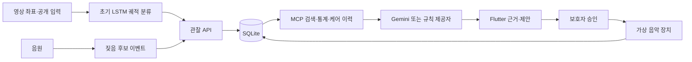

# 화요일 중간발표 — PetMind 개발 성과와 시연안

기준: 2026-10-11. 발표 예정: 2026-10-13.

## 목적과 해결하려는 문제

보호자가 반려견의 관찰 신호와 과거 기록을 함께 확인하고 케어 방법을 결정할 수 있도록 돕는다. 현재 영상·음성 신호만으로 감정이나 질환을 확정하지 않고, 개별 기록·관찰 근거와 함께 확인 방법을 제안한다.

## 시스템 구조

급식기는 포함하지 않는다. Gemini 실제 RAG·MCP·인용·HTTP 시나리오 성공을 파트 14에서 확인했다.

## 사용 기술과 이번 변경

- Python·NumPy: 기존 음성·규칙 분석과 합성 입력 재사용. 지속 소음 오탐·시간축·설정 오류 수정.
- PyTorch: 4종 합성 궤적을 학습하는 초기 LSTM과 저장 모델 추론.
- YOLOv8n·ByteTrack·OpenCV: 공개 이미지 재생 영상의 개 탐지·선택 ID 추적.
- FastAPI·SQLAlchemy·SQLite: 반려견별 관찰·제안·승인·명령·이력.
- 공식 MCP Python SDK: 실제 subprocess/stdio 도구 호출.
- 기록 검색: 반려견·기간·시각 필터와 키워드/라벨 관련도, SQL 집계. Gemini에 검색 근거를 전달하는 경로.
- Flutter: 입력·파형·궤적·검색 근거·인용·승인·타임라인·처리 수치.
- 별도 Python 가상 장치: 수신·완료·실패·시간초과 및 명령 ID 캐시.

## 현재 확인된 진행 상태

| 파트 | 확인된 성과 | 한계 |
|---|---|---|
| 실행·기존 분석 | 전용 환경, 21개 기존/회귀 테스트 | 실제 음성 분류기는 아님 |
| DB·API | 관찰·제안·명령 저장, 재시작 후 보존 | 로컬 시제품 |
| LSTM | 학습·저장·재로딩·추론, 합성 테스트 400개 100% | 실제 행동 정확도 미검증 |
| 공개 영상 | 개 추적 56개 샘플, 모델 출력 2.2초 | 재생 시간 재구성, 카메라 이동 미보정 |
| 공개 음원 | 20개 파일럿, 대조 음원 오탐 3개 확인 | 개별 짖음 정답 라벨 없음 |
| MCP·기록 검색 | 실제 도구 3개 호출·근거 저장·반려견 격리 | 검색 품질 평가 전 |
| Gemini | 실제 RAG·MCP·인용·HTTP 시나리오 검증 | 브라우저에서 연속 시연 확인 필요 |
| Flutter | 화면 흐름 테스트·분석·웹 빌드 통과 | 실제 브라우저 연속 시연 확인 필요 |
| 승인·가상 실행 | 완료·실패·30초 실제 시간초과 확인 | 물리 음악·Pi 미검증 |

근거 없는 전체 진행률 숫자 대신 이 확인표와 실행 기록을 보여준다.

## 3~5분 시연 순서

1. API와 가상 장치, Flutter 앱을 실행한다. 화면의 연결 상태를 확인한다.
2. 반려견 A에서 '합성 과거 기록 준비'를 누른다. 시드 데이터임을 설명한다.
3. '휴식 시연': 관찰과 과거 근거, 실행할 음악이 없는 결과를 보여준다.
4. '회전·짖음 시연': 저장 관찰, LSTM 종류, 후보 이벤트와 과거 기록을 보여준다.
5. 검색 근거의 기록 ID·출처와 MCP 도구 성공 상태를 설명한다. 실제 제공자가 rule/Gemini 중 무엇인지 표시한다.
6. 보호자 승인 전에는 명령이 없음을 설명하고 '가상 음악 실행 승인'을 누른다. 요청→수신→완료 상태와 타임라인을 보여준다.
7. 공개 음원과 준비된 영상 조합으로 분석·저장·제안을 실행한다. 실제 공개 입력이지만 서로 다른 자료의 합성 시연이며 원본 녹화 시간은 미검증이라고 밝힌다.
8. 반려견 B로 바꿔 A의 이력과 근거가 섞이지 않는 것을 보여준다.

실패/시간초과 로그와 서버 재시작 보존 기록은 질문 대응 자료로 준비한다. API 키·브라우저 상황 때문에 Gemini 실연이 안 되면 규칙 시연과 미완료 항목을 그대로 설명한다.

## 다음 개발 계획

- 발표 전: 실제 Gemini 호출·근거 인용, 브라우저 시연 확인과 영상 확보, 오류 대응 절차.
- 발표 후: 실제 영상·음원 라벨 확보, 고정 카메라 시간축·Pi 연동, 보호자 피드백.
- 최종 완성: 장기 개별 기록, 검색·모델 정확도 평가, 케어 전후 관찰과 장애 복구.
- 추가 후보 업데이트: 프로필·피드백·케어 전후 비교 화면과 API를 구현했다. 실제 데이터와 보호자 평가를 확보해 적용 검증하고, 평소 패턴은 충분한 실제 기록이 쌓인 뒤 평가한다.

합성 성적을 실제 반려견 정확도로, 가상 장치를 실장비 실행으로, 관찰 전후 차이를 음악의 인과 효과로 표현하지 않는다.
