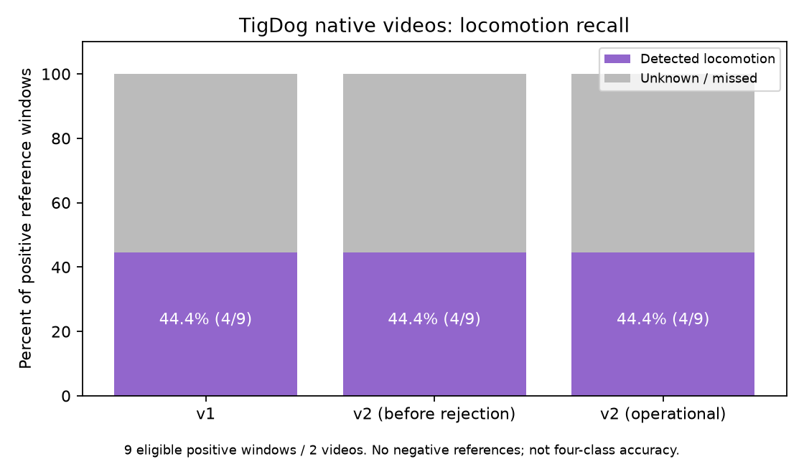

# 파트 25 — 실제 공개 데이터에서 개선 전·후 성능 측정

작성일: 2026-10-11. 사용자 요청: 실제 정확도 향상도 측정한다. 직접 촬영 영상·정답은 없으므로 공개 자료로 진행한다.

## 결론

**현재 측정에서 LSTM 개선으로 실제 성능이 향상됐다는 증거는 없다.** 합성 데이터 100%를 실제 행동 정확도로 사용하지 않았다. 운영 체크포인트는 변경하지 않았고, 테스트 자료로 재학습하거나 임계값을 맞추지 않았다.

| 측정 | v1 | v2 | 해석 |
|---|---:|---:|---|
| 실제 원본 영상의 이동 감지 재현율 | 4/9 = 44.4% | 4/9 = 44.4% | 변화 0%p. 전체 행동 정확도가 아님 |
| 실제 모션 좌표의 1초 예측 RMSE | 0.014386 | 0.014456 | v2 오차가 조금 더 큼 |

실제 영상 평가에는 비이동 정답 구간이 없었다. 회전·왕복을 포함한 4종의 독립 정답도 없다. 따라서 전체 accuracy·macro-F1·비이동 오탐률은 평가할 수 없다. 작은 평가에서 차이가 없다는 사실이 두 모델의 동등성을 증명하지 않는다.

## 실제 영상 자료 확보

[TigDog 공식 데이터](https://calvin-vision.net/datasets/tigdog/)와 그 원본인 [YouTube-Objects v2.2](https://calvin-vision.net/datasets/youtube-objects-dataset/)를 사용했다. 앞선 요청에서는 HTTP 406이었지만, 이번 정상 요청 헤더로 공식 다운로드에 성공했다.

- 사람의 프레임별 행동 판정 102개 shot, 22,427 프레임.
- 공식 dog JPEG 묶음 86,306장. 이 중 행동 라벨이 있는 구간만 평가 후보로 사용.
- 공식 원본 개 영상 24개 확보. 다른 동물 영상의 나머지 전송은 중단했다.
- dog JPEG 원본 묶음 SHA-256: `6a4b384b2fbfc47b51a525f42d0aed5bb68855bda2015c47e82f27a946c40847`.
- 이용 조건: 비상업 연구 목적. 원본·영상·이미지는 Git에서 제외했다. 배포자가 원영상 저작권을 소유한다고 보장하지 않는다.

파일별 해시·제공 경로·고정 모델 해시: [데이터 manifest](evidence/tigdog_manifest.json). 원본 영상 묶음 전체를 다운로드한 것이 아니므로 전체 묶음 체크섬·gzip CRC를 검증했다고 주장하지 않는다. 추출한 개 영상 각각의 로컬 SHA-256과 tar 헤더를 기록했다.

LSTM v1/v2 가중치는 이 자료로 학습하지 않았고 평가 전·후 해시가 같음을 확인했다. 데이터 출처가 다른 사전학습 detector의 공개 영상 중복 가능성까지 완전히 입증한 것은 아니다.

## 평가 기준과 라벨 매핑

프로젝트 모델은 `still/moving/spinning/pacing`, 자료의 정답은 `walking/running/turning_head/...`다. 같은 라벨로 간주하지 않았다.

- 정답의 walking, walking_backwards, running → 이동 사례.
- 머리·입·눈·핥기만 판정된 경우 → 비보행 국소 동작 후보. 이는 월드 좌표나 화면에서 완전히 정지했다는 보장이 아니다.
- 미라벨·몸 돌리기·점프·스케이트보드 등 비호환 항목 → 제외. 빈 라벨을 정지로 만들지 않음.
- 모델의 moving/spinning/pacing → 이동 출력으로 묶음. 이 매핑은 회전·왕복의 정확성을 검증하지 않음.
- 기본 50샘플·5Hz·약 10초 창을 유지. 정답의 동일 범주 순도 ≥90%.
- `unknown`과 추적 실패는 성공으로 계산하지 않음. 커버리지와 판정한 구간만의 성적은 별도 기록.
- 겹치는 시간 구간과 동일 입력 해시 중복을 방지. 여러 개가 검출돼 정답 개체 대응이 불확실하면 제외.

원본 영상 FPS·프레임 수, shot 범위, 처음·끝 JPEG와 원본 프레임의 픽셀 대응을 확인했다. 공식 JPEG는 축소 영상(예: 원본 1280×720 → 400×225)이므로 종횡비를 확인해 축소 후 비교했다. 마지막 비교는 운영 영상 분석처럼 **원본 영상 해상도와 실제 presentation timestamp**를 사용했다. 원본 시각 간격과 FPS 계산 차이도 0.05초 이내 조건으로 검사했다.

## 최종 원본 영상 결과

9개 비중복 구간, 원본 영상 2개(video 8, 13). 모두 이동 정답이었다.

| 모델/처리 | 이동 출력 | unknown | 이동 재현율 |
|---|---:|---:|---:|
| v1 기존 거부 정책 | 4 | 5 | 44.4% |
| v2 확률·좌표 급변 거부 전 | 4 | 5 | 44.4% |
| v2 운영 거부 정책 | 4 | 5 | 44.4% |

unknown의 원인은 마지막 추적 누락 4구간, 추적 간격/시간 부족 1구간이었다. 시간 조건을 통과한 일부 구간에도 순간 누락과 ID 연속성 문제가 있었다. 예측한 4개는 넓은 이동 범주에 맞았지만, 양성만 있는 평가여서 이 사실을 100% 실제 행동 정확도라고 부를 수 없다.

배제 사유: 원본 10초 미만 58개 shot, FPS/프레임 대응 미확인 16개 shot, 혼합·비호환 정답 24개 window, 개체 불명확 4개 window. 단위가 다르므로 이를 전체 데이터 중 성공률의 분모로 섞지 않는다.

원본 영상별 paired bootstrap의 차이는 이 표본에서 0%p였다. 영상이 2개뿐이고 양성만 있어 일반화 성능·동등성 판단에는 부족하다. 사례별 추적 수·원본 FPS/PTS·정답·출력·모델 해시: [최종 JSON](evidence/tigdog_original_evaluation.json).



### 먼저 측정한 축소 JPEG 입력

JPEG 입력에서는 적격 구간 12개, v1 3/12(25%), v2 운영 정책 2/12(16.7%)였다. 원본에서는 해상도 차이로 추적 및 여러 개 검출 결과가 달라져 동일한 개체 필터를 통과한 구간도 9개로 달라졌다. 이 두 평가의 차이를 LSTM 개선 효과로 계산하지 않는다. [초기 JPEG 결과](evidence/tigdog_jpeg_exploratory_evaluation.json)를 삭제하지 않고 보존했다.

## 실제 모션 좌표에서의 보조 비교

AI4Animation의 실제 좌표 195/12/13 구간(train/validation/test)을 사용했다. 고정된 v1/v2 LSTM의 은닉 특징에 같은 선형 예측기를 학습시켜 다음 1초의 실제 좌표를 예측했다. 정답 좌표는 원본 기록이며 사람이 임의 행동 라벨을 붙이지 않았다. 실제 행동 분류의 대체 성적은 아니다.

- test MSE: v1 `0.000206949`, v2 `0.000208986` → v2 약 0.98% 높음.
- 촬영 그룹을 같은 비중으로 비교하면 v2 약 4.43% 높음. 탐색적 bootstrap 오차 감소율 95% 범위는 `-6.83% ~ +0.98%`로 개선을 뒷받침하지 않음.
- 13구간은 촬영 그룹 4개, 개 한 마리. 이전 탐색에서 사용한 분할이므로 새로운 블라인드 시험이 아님.
- 선형 예측기는 보조 검사에만 사용. 운영 모델·API를 이 가중치로 교체하지 않음.

[좌표 비교 JSON](evidence/lstm_real_paired_forecasting.json), 로컬 그래프 `artifacts/real_evaluation/forecast_comparison.png`.

## 추가·수정 파일과 실행

| 파일 | 이유 |
|---|---|
| `scripts/measure_lstm_real.py` | 실제 좌표의 고정 v1/v2 비교, 촬영 그룹 bootstrap, 출처·모델 해시 |
| `scripts/download_research_archive.py` | 공식 대용량 자료의 재개 가능한 범위 다운로드, 버전·응답 길이 검사 |
| `scripts/extract_original_dog_videos.py` | 필요한 개 영상만 확보하고 나머지 전송 중단 가능 |
| `scripts/evaluate_tigdog.py` | 사람 정답·원본 시각·비호환 라벨·추적 실패를 분리한 실제 영상 평가 |
| `tests/test_real_evaluation.py` | 미라벨의 오라벨 방지, unknown 실패 계산, 클래스 누락, 촬영 그룹 평가 |

```powershell
.\.venv\Scripts\python.exe -X utf8 -m scripts.measure_lstm_real
.\.venv\Scripts\python.exe -X utf8 -m scripts.evaluate_tigdog --input-mode original
```

원본 자료는 로컬 `artifacts/datasets/tigdog`, 결과는 `artifacts/real_evaluation`에 있다. 운영 모델과 기존 서비스는 유지했다. 전체 Python 테스트 **55 passed**, `pip check` 정상. 이 작업은 평가 코드 중심이며 Flutter 변경은 없다.

## 다음 우선 작업

1. 추적 누락·ID 단절을 줄이고, 카메라 이동 영향을 구분한다. 한 사례는 개가 매우 작고 흐릿하며 다른 사례는 사람이 많은 보행 장면이다.
2. 실내 고정 카메라 조건과 맞는 자료를 확보한다. 공개 영상에도 원본 시간을 유지하고, 정지·이동·회전·왕복을 모델 출력과 독립적으로 판정할 라벨링이 필요하다.
3. 학습·검증용 공개 영상을 원본 영상/개체 단위로 나눠 개선한다. 최종 성능은 이번에 살펴본 영상과 별도의 새 테스트 세트로 확인한다.
4. 이번 9개만 반복 학습하거나 시험 점수가 높아지도록 거부 기준을 낮추지 않는다. 데이터 확보 전 ‘실제 4종 정확도 향상’은 미완료다.
