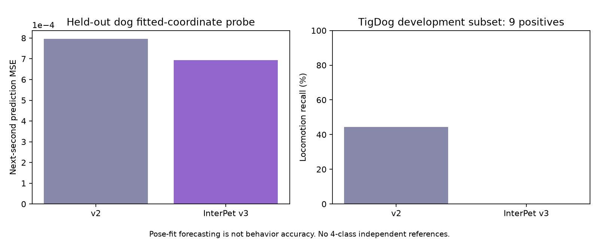

# 파트 27 — InterPet4D 실제 적용과 평가

작성일: 2026-10-11. 사용자 선택에 따라 영상 모델에 집중했다. 센서 실험은 이번 범위에서 제외했다.

## 결론

공식 공개 InterPet4D 자료를 실제로 내려받아 기존 LSTM의 사전학습에 사용하고 후보 모델 v3를 학습했다. **좌표 예측은 개선됐지만, 현재 영상 행동 처리 성능은 개선되지 않았다. 후보를 기본 모델로 교체하지 않았다.**

| 평가 | 기존 v2 | InterPet 후보 v3 | 판단 |
|---|---:|---:|---|
| 학습에 없는 반려견의 좌표 예측 MSE | 0.000796576 | 0.000694323 | 약 12.84% 감소. 행동 정확도가 아님 |
| TigDog 이동 재현율, 동일 9개 구간 | 44.4% | 0% | 후보의 거부 처리로 성능 악화 |
| InterPet 테스트 영상 2개, 준비 시간 이후 분류 커버리지 | 0% | 0% | 추적 ID 연속성 문제로 분류 불가 |



## 데이터 적용

- [공식 배포](https://huggingface.co/datasets/ohicarip/interpet4d), revision `7835a62bbe1ca3a37cb9957186700b1eb6e40c44` 고정.
- CC BY-NC 4.0. 연구·비상업 이용, 원본은 Git에서 제외.
- 공개 cleaned SMAL 파일 225개, 약 219.4MB 확보. 실제 제공된 파일의 반려견 ID는 12개다. 데이터셋 전체의 13마리 설명과 구분한다.
- 기존 중심 궤적 LSTM을 유지하기 위해 제공된 월드 루트 X/Y 궤적을 사용했다. 213개 자세 특징 전체를 영상에서 실시간 추출하는 모델을 새로 만든 것은 아니다.
- 이 자료는 자동 추정·정제된 자세이다. 전문가의 4종 행동 정답이나 실제 모션 센서 좌표로 취급하지 않는다. 클립 설명을 프레임별 행동 라벨로 변환하지 않았다.
- 원본 `frame_idx / source_fps(60)` 시간축과 제작자의 temporal segment 경계를 사용했다. 단절된 구간을 연결하거나 짧은 영상을 10초로 늘리지 않았다.
- 최대 원본 시간 간격 0.2초, quality weight≥0.5인 프레임 비율≥90%, 중앙 재투영 오차≤40px 조건 적용. 파일·중심 이동을 제거한 궤적의 해시 중복 검사.
- body unit 좌표에 고정 scale 10 적용. 카메라 화면 좌표와 같은 분포라는 보장은 없으며 실험 결과의 주요 한계다.

제작자가 제공한 train/val에는 같은 반려견이 섞여 있어 반려견 단위로 다시 분할했다.

| 분할 | 반려견 | 10초 구간 |
|---|---|---:|
| train | dog01,02,03,06,07,09,11,12 | 89 |
| validation | dog04,05 | 14 |
| test | dog08,10 | 21 |

품질/연속성 조건으로 사용할 구간이 없는 클립은 118개였다. 해시·파일별 분할·배제 사유는 [manifest](evidence/interpet_manifest.json)에 저장했다. 정제 데이터의 시간 평활화와 전체 클립 기반 정규화 때문에 이 좌표 예측 검사는 실시간 카메라의 독립 ground truth 평가가 아니다.

## 학습과 비교

기존 8특징·48 hidden LSTM을 유지했다. InterPet 루트의 다음 1초 예측 사전학습 60 epoch 후 기존 합성 4종 분류 45 epoch로 학습했다. 체크포인트 선택에는 validation만 사용했다. 실제 행동 라벨은 부족하므로 분류 head의 정답은 여전히 합성이다.

합성 validation/test 각 400개 argmax 정확도 100%, 네 기본 시나리오도 일치했다. 이 성적을 실제 행동 정확도로 사용하지 않는다. 후보는 `artifacts/lstm_interpet/trajectory_lstm.pt`에 저장했다. 운영 `artifacts/lstm/trajectory_lstm.pt`는 기존 v2로 유지했다.

고정된 v1/v2/v3의 은닉 특징에 같은 절차의 선형 예측기를 붙여 InterPet train으로 학습하고 validation으로 규제를 선택한 뒤 test 21구간을 평가했다. v3 대 v2 MSE 감소는 12.84%다. 테스트 반려견이 두 마리뿐이며 자동 추정 좌표라는 점 때문에 일반화·행동 정확도 개선의 증거로 확대하지 않는다. [좌표 비교](evidence/interpet_forecast_comparison.json), [학습 기록](evidence/interpet_training.json).

TigDog 원본 영상의 이전과 동일한 조건·동일한 9개 이동 정답 구간에서 후보를 추가 평가했다. v2의 4개 이동 출력이 v3에서는 모두 낮은 확신도/클래스 모호성으로 unknown이 됐고, 나머지 5개는 원래 추적/시간 문제였다. 확신도 기준을 테스트 결과에 맞춰 낮추지 않았다. 이전에 살펴본 개발 평가 세트여서 새로운 블라인드 시험은 아니다. 비이동 정답이 없어 전체 accuracy/macro-F1을 계산하지 않는다. [후보 비교 결과](evidence/interpet_tigdog_comparison.json).

## 학습에서 제외한 InterPet 실제 영상

테스트 반려견마다 첫 품질 적격 클립을 모델 출력 확인 전에 선택했다. 원본 ego 영상을 실제 YOLOv8n→ByteTrack→기존 LSTM 경로로 처리하고 v2/v3 모두 실행했다. 네 출력 영상의 디코딩을 확인했다.

| 반려견/원본 영상 | 샘플 프레임 | 개 검출 | 어떤 ID든 추적 | 선택 ID 추적 | 다른 ID만 추적 |
|---|---:|---:|---:|---:|---:|
| dog08, 약 24.55초 | 123 | 91 | 86 | 29 | 57 |
| dog10, 약 26.44초 | 133 | 100 | 95 | 29 | 66 |

두 모델 모두 전체 구간 unknown이다. 검출 자체가 계속 없었던 것은 아니다. 첫 선택 ID가 다른 ID로 바뀌거나 사라진 뒤 기존 `video.py`는 선택 ID를 갱신하지 않는다. 따라서 다른 ID로 잡힌 프레임이 LSTM 입력으로 들어오지 않는다. 같은 개임을 확인해 이어 주는 재연결/재획득이 필요하다. 여러 개가 보이는 경우 임의의 ID를 이어 붙이면 데이터가 오염되므로 별도 확인이 필요하다.

실제 클립: `dog08_p17_take01_ego_001`, `dog10_p07_take01_ego_001`. 원본 FPS는 각각 약 59.754 / 59.937이다. 움직이는 ego 카메라 조건이며 실내 고정 카메라와 다르다. 클립 설명에는 행동별 시간 정답이 없어 행동 accuracy는 null로 기록했다. [영상 평가·추적 진단](evidence/interpet_video_evaluation.json).

로컬 영상 경로:

- `artifacts/interpet_evaluation/videos/dog08_p17_take01_ego_001_v3/tracked.mp4`
- `artifacts/interpet_evaluation/videos/dog10_p07_take01_ego_001_v3/tracked.mp4`

## 변경 파일·검증

| 파일 | 내용 |
|---|---|
| `scripts/prepare_interpet.py` | 공식 자료 다운로드·버전 고정·품질·시간·반려견 분할·중복 검사 |
| `scripts/train_lstm.py` | 데이터별 단위/출처를 유지하며 기존 사전학습 경로 재사용 |
| `scripts/measure_lstm_real.py` | 선택 데이터와 후보 모델을 동일 절차로 비교 |
| `scripts/evaluate_tigdog.py` | 기존 평가 조건에 후보 추가, 별도 결과 경로 |
| `scripts/evaluate_interpet_video.py` | 테스트 반려견 원본 영상 다운로드·모델 비교·추적 진단 |
| `pet_monitor/video.py` | 프레임별 검출 수·ID·선택 ID 일치 진단 추가. 추적/분류 정책은 유지 |
| `tests/test_interpet_data.py` | 실제 시간축·segment 단절·나쁜 품질·잘못된 시간 입력 회귀 검사 |

전체 Python 테스트 **57 passed**. 기존 v2·v1 백업 파일은 유지했다. 서비스의 기본 모델·승인·장치 동작을 바꾸지 않았다. 프런트엔드 변경은 없다.

```powershell
.\.venv\Scripts\python.exe -X utf8 -m scripts.prepare_interpet
.\.venv\Scripts\python.exe -X utf8 -m scripts.train_lstm --pretrain-data artifacts/datasets/interpet4d/windows.npz --output artifacts/lstm_interpet
.\.venv\Scripts\python.exe -X utf8 -m scripts.measure_lstm_real --dataset artifacts/datasets/interpet4d/windows.npz --candidate artifacts/lstm_interpet/trajectory_lstm.pt --output artifacts/interpet_evaluation/forecast
.\.venv\Scripts\python.exe -X utf8 -m scripts.evaluate_tigdog --candidate artifacts/lstm_interpet/trajectory_lstm.pt --output artifacts/interpet_evaluation/tigdog
.\.venv\Scripts\python.exe -X utf8 -m scripts.evaluate_interpet_video --candidate artifacts/lstm_interpet/trajectory_lstm.pt
```

## 다음 우선순위

추적 ID 재획득과 카메라 이동 영향을 먼저 해결한다. 월드 자세 사전학습을 화면 중심 좌표에 그대로 옮기는 방식의 한계를 검토하고, 실제 영상에서 얻을 수 있는 자세 특징 및 독립 행동 시간 라벨로 후속 학습을 준비한다. 실제 4종 정확도 개선은 아직 입증되지 않았으며, 이번 후보를 채택하지 않는 것이 현재 결과에 맞는 결정이다.
