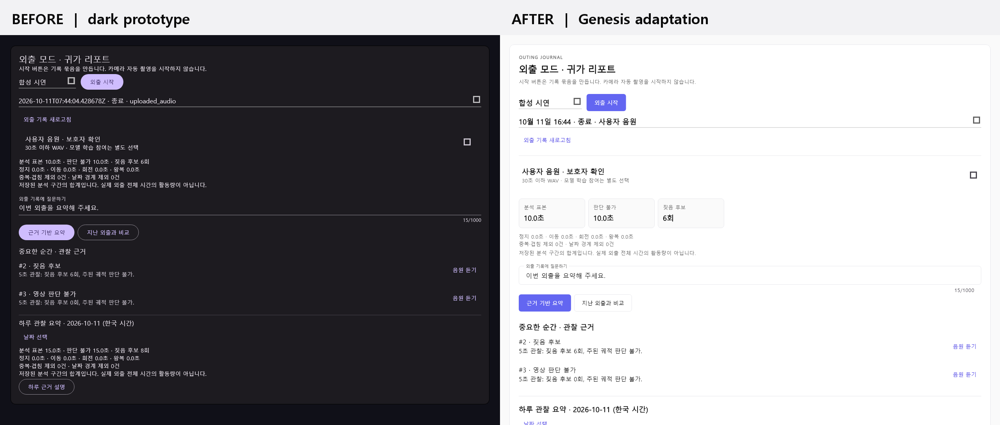
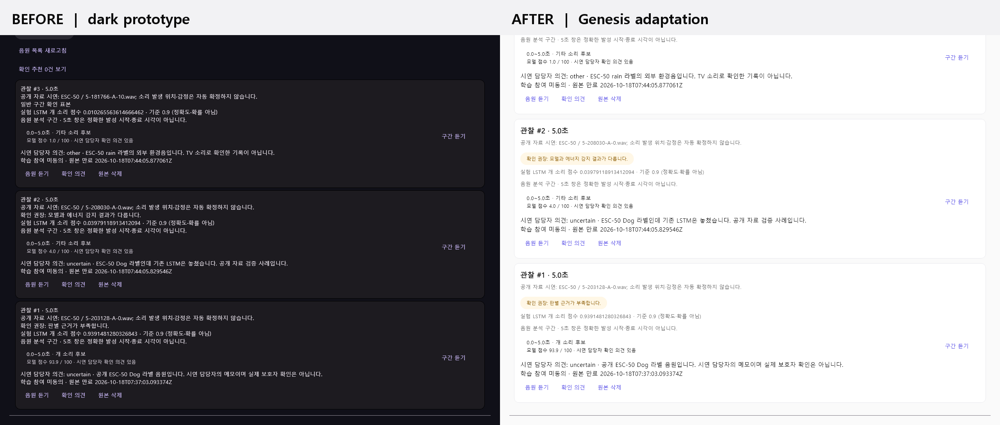
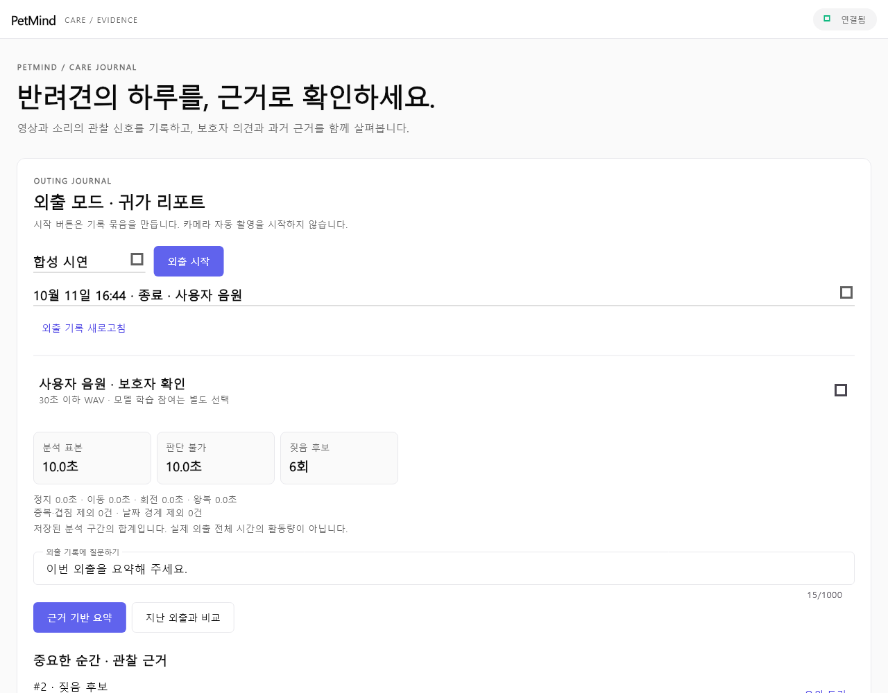
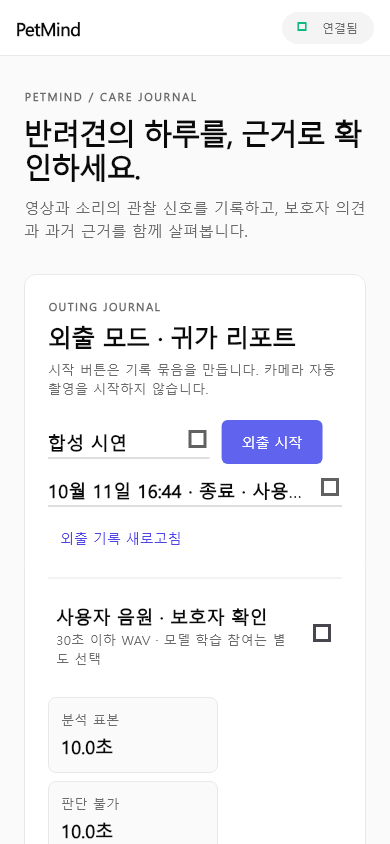

# Genesis 스타일 적용과 기존 UI 비교

기준일: 2026-10-11. 사용자가 제공한 `genesis-DESIGN.md`의 **시각 원칙**을 PetMind Flutter 화면에 맞게 적용했다. 원본 문서는 개발자 커뮤니티 서비스용이므로 갤러리·검색·다운로드·햄버거 메뉴 등 PetMind와 무관한 기능은 추가하지 않았다. 외출, 음원 구간, 보호자 확인, 근거 설명의 기능과 API는 유지했다.

## 화면 비교

| 항목 | 기존 UI | 적용 후 |
|---|---|---|
| 색상·표면 | 어두운 배경과 보라색 강조 | `#FAFAFA` 배경, 흰색 카드, 얇은 `#E8E8EC` 테두리, 인디고 동작 버튼 |
| 정보 위계 | 수치·설명·행동이 같은 밀도로 이어짐 | 제목·설명·핵심 수치·근거를 분리하고 여백을 늘림 |
| 외출 기록 | 원시 ISO 시각과 `uploaded_audio` 코드 노출 | 한국 시간의 날짜·시각과 “사용자 음원” 같은 읽기 쉬운 상태 표시 |
| 귀가 요약 | 분석·판단 불가·짖음 후보 수치를 한 문장에 표시 | 세 수치를 독립 타일로 배치하고 추정 한계 문구는 유지 |
| 음원 검토 | 검토 우선순위와 모델 수치가 일반 문장 | 검토 우선순위 칩, 제목/출처/분석 구간의 시각적 분리 |
| 공개 입력 분석 신호 | 다크 배경과 보라색 파형·궤적 | 밝은 배경과 짙은 회색 선으로 카드 색 체계에 통일 |
| 좁은 화면 | 상단 및 프로필 행이 공간을 강하게 요구 | 상단 보조 문구를 숨기고 프로필 행을 줄바꿈 가능하게 변경 |

후속 사용성 점검에서 모바일 외출 선택 항목의 긴 문구가 잘리는 것을 확인했다. 현재 화면은 선택된 항목을 `10/11 17:00 · 종료 · 음원`처럼 축약하고, 목록을 펼쳤을 때 전체 날짜와 입력 모드를 보여준다. 아래 모바일 이미지는 이 수정 전 디자인 적용 시점의 캡처다.

오류 안내의 기본 주황색은 밝은 `#FAFAFA` 배경에서 대비가 약 2.06:1이었다. 현재는 경고 본문에 `#8A5A00`을 사용해 약 5.68:1로 높였다. 인디고 동작 버튼과 의미별 상태 색의 구분은 유지했다.

새 UI의 첫 화면은 아래와 같다. 모바일 화면은 폭 390px 기준이다.

**장점:** 핵심 관찰 수치와 근거 확인 버튼을 빠르게 찾을 수 있고, 공개 음원·판단 불가·5초 분석 창의 한계를 계속 드러낸다. **대가:** 카드와 여백이 커져 하루 요약과 아래쪽 기능에 도달하려면 기존보다 더 스크롤해야 한다. 시연에서는 외출 카드부터 근거 장면으로 내려가는 흐름을 안내하는 편이 좋다.

## 적용 범위와 검증

- `petmind_app/lib/genesis_theme.dart`: 색상·타이포그래피·카드·버튼·입력·칩을 공통 테마로 정의했다. 상태 색은 연결/검토 의미에만 사용한다.
- `petmind_app/lib/main.dart`: 앱 바, 소개 문구, 섹션 구분과 모바일 줄바꿈을 적용했다.
- `petmind_app/lib/outings_panel.dart`: 외출 기록 표기, 핵심 수치 타일과 설명 위계를 적용했다.
- `petmind_app/lib/audio_panel.dart`: 보호자 검토 카드, 우선순위 칩과 구간 설명을 적용했다.
- `petmind_app/test/widget_test.dart`: 390px 화면에서 앱 바 및 스크롤 영역의 넘침을 확인한다.
- `tests/test_fsd_archive.py`: 전체 Python 회귀에서 드러난 기존 FSD 테스트의 누락된 `deadline` 인자를 보완했다. UI 기능 변경은 아니다.

스크린샷은 **공개 자료로 만든 시연 API 응답을 Flutter 위젯 테스트에 공급해 렌더링한 이미지**다. 디자인 적용 시점의 이미지여서 새 외출 기본값은 ‘합성 시연’으로 보이지만, 현재 실행 화면은 ‘사용자 음원’을 기본으로 한다. 실제 브라우저 클릭 녹화나 실제 반려견의 장기 기록으로 해석하면 안 된다. 캡처에는 한글을 읽을 수 있도록 Windows의 Malgun Gothic을 사용했다. 원본 디자인에서 지정한 General Sans·DM Sans 이름은 테마에 설정했지만 글꼴 파일을 앱에 포함하지 않았으므로 설치 환경의 대체 글꼴이 사용될 수 있다. 따라서 글꼴 획 모양까지 원본 디자인과 동일하다고 주장하지 않는다.

검증: `flutter analyze`, `flutter test`, `flutter build web --release --no-web-resources-cdn`, `python -m pytest tests petmind/backend/tests -q -p no:cacheprovider`.
