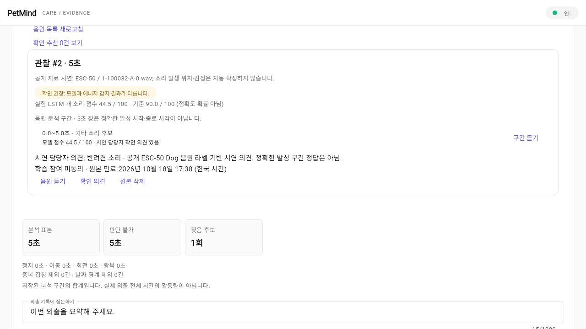
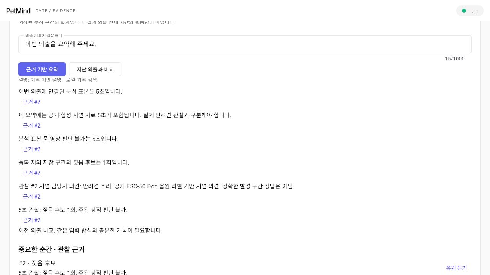
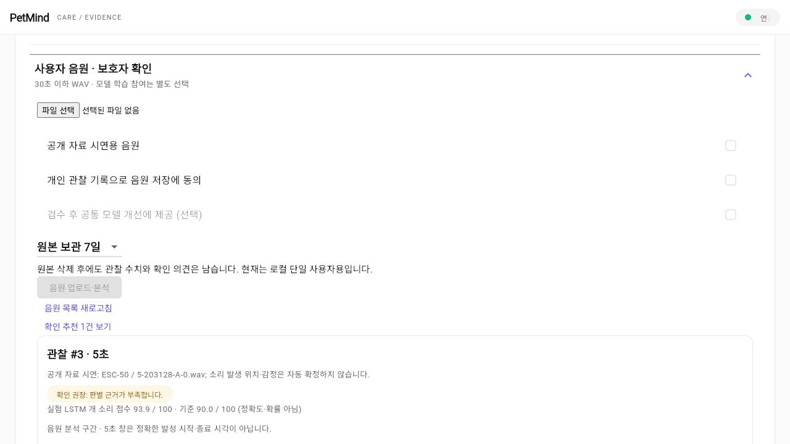
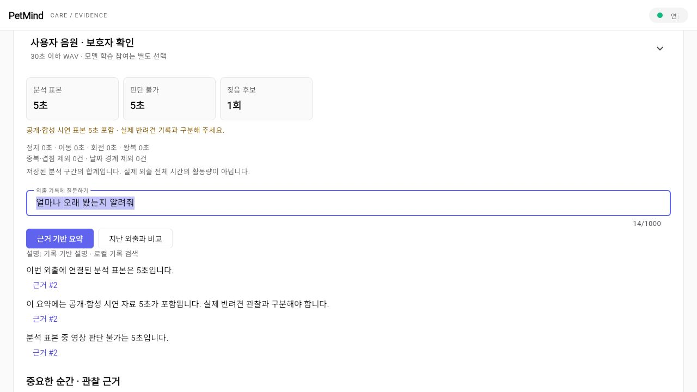

# 자체 피드백: 화면 안정성·자료 출처·시연 사용성

기준일: 2026-10-11. 기존에 정상 동작하던 모델·RAG 검증 체계는 유지하고, 실제 사용과 시연을 방해하는 부분을 우선 수정했다.

## 발견한 문제와 수정

| 문제 | 영향 | 수정 및 확인 |
|---|---|---|
| 3초 자동 새로고침과 오래된 응답 | 느린 요청이 최신 관찰을 덮어쓰고 선택 API까지 반복 호출 | 주기를 15초로 조정하고, 진행 중인 호출은 건너뛰며, 최신 요청의 응답만 화면에 반영한다. 선택 목록·프로필은 최초/수동 새로고침 때 조회한다. 지연 응답 회귀 테스트를 추가했다. |
| 선택 API 장애가 전체 연결 장애처럼 표시 | 관찰 API가 정상이어도 기록을 볼 수 없는 것처럼 보임 | 선택 기능 실패는 별도로 안내하고 관찰·세션 화면을 유지한다. 수동 재시도와 복구 위젯 테스트를 추가했다. |
| 원본 WAV 유실 또는 만료 | 목록에는 재생이 가능하다고 표시되지만 플레이어는 실패 | 음원 목록의 `audio_available`을 파일 존재·만료·삭제 상태로 계산한다. 원본 파일 누락 회귀 테스트를 추가했다. |
| 공개·합성 시연과 실제 사용자 음원의 출처 혼동 | 시연 결과가 반려견의 실제 관찰이나 비교 가능한 이전 외출처럼 해석될 수 있음 | 요약에 `demo_sample_seconds`, `demo_observation_ids`, `input_scopes`를 추가했다. 귀가 화면과 근거 설명에 시연 표본을 표시하고 출처 범위가 다른 직전 세션 비교는 제한한다. API·Flutter 테스트로 확인했다. |
| 업로드 직후 이전 파일·동의·출처가 남음 | 다음 음원에 이전 입력 조건이 잘못 적용될 수 있음 | 성공 후 파일 선택과 동의·출처를 초기화한다. 공개 시연을 다시 선택할 때 출처도 새로 입력한다. 업로드별 독립 입력 위젯 테스트를 추가했다. |
| 밝은 UI의 파일 선택기·음원 플레이어·검토 정보 | 글자 대비가 낮고 내부 코드·UTC 만료 시각이 이해하기 어려움 | 파일 선택기와 플레이어를 밝은 테마에 맞추고 검토 결과·점수·만료 시각을 사용자용 한국어로 표시했다. 점수를 정확도나 확률로 오해하지 않도록 설명은 유지했다. |
| 전체 서버 장애의 원시 오류 표시 | 재연결 방법이 불명확 | 연결 안내와 재시도 버튼을 표시하고, 서버 중단·복구 위젯 테스트를 추가했다. |
| 자연스러운 시간 질문의 검색 누락 | “몇 분이나 쌓였나요”, “얼마나 오래 봤나요”에 분석 표본 시간 근거가 검색되지 않음 | 시간 질문 의도 판별을 보완했다. 기존 개발자 질문 12개에서 근거 조건 10→12개 통과하고, 두 표현의 API 회귀 테스트를 추가했다. [최종 재평가 결과](evidence/outing_retrieval_validation_v5.json)를 저장했다. 이 12개는 결과를 확인해 수정한 개발 자료이므로 독립 정확도가 아니다. |
| 발표용 공개 음원 준비에 전체 데이터 다운로드 필요 | 새 환경에서 짧은 시연 준비가 오래 걸림 | `python -m scripts.prepare_demo_audio`를 추가했다. 공식 ESC-50 평가 분할 1·5의 Dog 3개·rain 1개만 고정 리비전에서 받으며 메타데이터·해시·WAV 형식을 검증한다. 기존 로컬 자료와 실제 원격 다운로드 경로를 각각 실행해 네 파일을 확인했다. 출력은 Git 제외 `artifacts/`에 둔다. |
| 짧은 시간 질문의 장황한 답변 | 분석 분량을 물어도 소리·의견·이전 외출 안내까지 나와 핵심 수치를 찾기 어려움 | 시간 질문만 있는 경우 표본 시간·시연 출처·판단 불가 근거로 검색 범위를 좁히고, 이전 외출 안내는 비교 질문에만 표시한다. 기존 12문항 근거 조건은 그대로 통과했고 회귀 테스트를 추가했다. |
| 시연 전 모델 준비 상태 불명확 | 새 환경에서 음원만 준비하면 LSTM 점수도 나오는 것으로 오해 가능 | `/health`에 `audio_lstm_checkpoint_present`를 추가하고 README에서 별도 로컬 체크포인트 필요성을 명시했다. 파일 존재만 알려주는 값이며 모델 추론 성공이나 정확도를 보증하지 않는다. |
| 보조 요약 API 장애가 기본 기록까지 가림 | 확인 추천 또는 하루 요약 조회 실패 시 음원·외출별 기록 갱신이 멈춤 | 음원 목록과 외출별 보고서를 먼저 표시하고 보조 조회 실패만 안내한다. 다시 새로고침해 복구되는 위젯 테스트를 추가했다. |
| HTML 오류 페이지가 앱 내부 예외로 노출 | 프록시나 서버 오류 때 JSON 형식 오류를 그대로 표시 | 음원·외출 패널에서 HTTP 상태와 재시도 안내로 바꾸고 HTML 502/503 회귀 테스트를 추가했다. |
| 새 외출 기본값이 과거 합성 시연 모드 | 사용자 음원을 올리려다 입력 모드가 달라 업로드가 막힐 수 있음 | 새 외출의 기본값과 목록 첫 항목을 사용자 음원으로 바꾸고, 실제 시작 요청의 `input_mode`를 검증했다. 합성·준비 영상 모드는 계속 선택할 수 있다. 새 웹 빌드의 브라우저 첫 화면도 다시 캡처했다. |
| 다른 입력을 누를 때 진행 중 모드 이름이 틀림 | 음원 외출 중 합성/공개 입력을 누르면 각각 영상/합성 모드라는 잘못된 안내가 나옴 | 실제 외출의 입력 모드 이름과 다음에 필요한 모드를 함께 표시한다. 음원 외출에서 합성 입력 요청을 보내지 않는 위젯 테스트를 추가했다. |
| 상단 연결 상태가 화면에서 잘림 | 실제 브라우저에서 연결 표시가 ‘연…’처럼 보여 상태를 읽기 어려움 | 글자 폭을 따르는 상태 표시로 바꾸고 390px 화면 테스트·실제 브라우저 캡처에서 ‘연결됨’ 전체를 확인했다. |
| 보조 실행·이력·지표 API 실패가 전체 연결 장애로 표시 | 관찰 조회가 정상이어도 메트릭 한 경로의 503 때문에 화면이 ‘연결 끊김’으로 바뀜 | 최근 실행·처리 타임라인·집계 지표는 기존 값과 실패 안내를 유지한다. 관찰 #8을 계속 표시하고 재조회 뒤 안내가 사라지는 위젯 테스트를 추가했다. |
| RAG가 이전 외출의 관찰을 인용할 때 원본 링크가 열리지 않음 | 화면이 현재·직전 외출 요약에 포함된 관찰만 찾아, 더 오래된 검색 근거를 ‘연결된 영상 없음’으로 처리 | 반려견 범위를 확인하는 `GET /outings/observations/{id}/evidence`를 추가해 기록의 현재 원본 가용성을 조회한다. 귀가·하루 설명의 근거 버튼이 이를 통해 음원·영상 원본을 연다. 과거 외출의 인용, 다른 반려견 접근 차단, 화면 대화상자 회귀 테스트를 추가했다. 원본이 삭제됐다면 재생 불가를 명시한다. |
| 모바일 외출 선택 항목의 긴 문구가 잘림 | 날짜·종료 상태·입력 모드를 한 줄에서 구분하기 어려움 | 600px 미만에서는 선택된 항목을 짧은 날짜·상태·입력명으로 표시한다. 펼친 목록의 전체 문구는 유지하고 390px 위젯 테스트를 추가했다. [디자인 비교](37_Genesis_UI_적용_비교.md)의 모바일 이미지는 수정 전 캡처임을 명시했다. |
| 밝은 배경의 오류 안내가 연한 주황색 | `#FAFAFA` 위 기본 주황색 글자의 대비 약 2.06:1로 읽기 어려움 | 경고 본문 색 `#8A5A00`(약 5.68:1)을 공통 토큰으로 적용했다. Flutter 18개 테스트, 정적 분석·웹 빌드를 다시 확인했다. |
| 공개 입력 파형·궤적이 이전 다크 테마 색으로 남음 | 밝은 Genesis 카드 아래 검은 사각형과 보라색 선이 시각적으로 분리됨 | 분석 신호의 배경을 `#FAFAFA`, 선을 `#6B6B6B`로 바꿨다. 데이터 계산과 좌표는 그대로 두었고 Flutter 18개 테스트·정적 분석·웹 빌드를 확인했다. |
| 웹 접근성 트리가 기본으로 꺼짐 | 화면 읽기 도구와 브라우저의 버튼·입력 요소 인식이 제한됨 | [Flutter 공식 웹 접근성 지침](https://docs.flutter.dev/ui/accessibility/web-accessibility)대로 웹에서 의미 트리를 활성화했다. 실제 브라우저에서 ‘지난 외출과 비교’와 ‘근거 #2’를 이름으로 눌러 원본 대화상자가 열리는지 확인했다. Flutter 18개 테스트·정적 분석·웹 빌드 통과. 웹 의미 트리 생성에는 성능 비용이 있으므로 기기별 사용성은 후속 확인 대상이다. |
| 편집 설명 영상만 있어 실제 조작 흐름 증명이 약함 | UI 화면들이 한 세션에서 이어지는지 영상으로 확인하기 어려움 | 별도 시연 DB에서 Edge 자동 조작으로 외출 시작→WAV 업로드→출처·동의→시연 의견→귀가 요약→원본 플레이어까지 30.6초 연속 녹화했다. [영상 범위와 파일 위치](39_Genesis_브라우저_설명영상.md)를 구분해 기록했다. |

## 실제 브라우저 확인

별도 `artifacts/ui_validation.db`에서 규칙 기반 설명과 로컬 검색을 사용했다. `demo-dog`의 합성 외출 시작·관찰·종료·근거 요약을 확인했다. 이어 ESC-50 공개 음원 `1-100032-A-0.wav`를 **공개 자료 시연**으로 업로드해 5초 구간, 짖음 후보, 모델 점수 44.5/100(기준 90/100), 시연 담당자 의견, 원본 WAV 재생·일시중지, 귀가 설명의 출처 표기를 확인했다. 귀가 설명은 분석 5초, 판단 불가 5초, 짖음 후보 1건, 시연 자료 5초와 관찰 #2 근거를 함께 제시했다.

이어 두 번째 Dog 자료 `5-203128-A-0.wav`를 파일 선택 버튼으로 업로드했다. 저장된 관찰 #3의 실험 점수 93.9/100과 출처가 표시됐고, 다음 입력의 파일·공개 시연 체크·저장 동의가 빈 상태로 돌아온 것을 확인했다.

백엔드와 웹을 최신 코드로 다시 실행한 뒤, 브라우저에서 “얼마나 오래 봤는지 알려줘”를 물었다. 귀가 설명은 저장된 분석 표본 5초, 같은 5초의 공개 시연 출처와 영상 판단 불가 시간을 각각 근거 #2와 함께 제시했다. 이 질문에는 무관한 소리·의견·이전 외출 안내가 나오지 않았다. 이 브라우저 확인은 규칙 기반 제공자와 로컬 검색 조건이다.

이 화면들은 실제 로컬 브라우저와 별도 시연 DB의 결과다. 스크린샷에는 공개 자료의 파일명과 시연 담당자 의견만 들어 있다. 개인 음원 원본·데이터베이스·API 키는 저장소에 포함하지 않는다. 이 확인은 화면 흐름과 출처 표시의 검증이며 실제 반려견 환경의 감지 정확도 측정은 아니다.

## 검증 결과와 남은 일

- Python 전체 회귀: 115개 통과.
- Flutter 정적 분석: 문제 없음. Flutter 테스트: 18개 통과. 웹 릴리스 빌드 완료.
- 실제 브라우저: 외출 시작·종료, 음원 업로드·검토, 근거 구간 재생, 귀가 설명, 서버 장애·복구를 확인했다.
- 실제 반려견의 홈캠·마이크 음원에 대해 보호자가 단 정답을 확보하고, 공개 음원 오탐·놓침과 분리하여 현장 성능을 평가해야 한다. 실시간 마이크 입력과 계정별 접근 제어도 후속 범위다.

## Git 파일만 있는 별도 작업 폴더 검증

2026-10-11에 체크포인트·캐시·개인 DB가 없는 별도 Git 작업 폴더(`f594f8c`)를 만들어 확인했다. 이미 설치된 외부 Python 가상환경과 Flutter SDK는 재사용했으므로 **의존성 설치를 새로 검증한 것은 아니다**.

- Python 전체 회귀: **113 통과, 1 건너뜀**. 건너뛴 항목은 Git 제외 모델 산출물에 의존한다. 같은 코드의 모델 산출물이 있는 개발 폴더에서는 **114 통과**했다.
- Flutter: **15 테스트 통과**, 정적 분석 문제 없음, 웹 릴리스 빌드 완료.
- `python -m scripts.prepare_demo_audio`: 캐시 없는 상태에서 공식 원격 자료 4개 다운로드, 메타데이터·원본 출처·해시 검증 통과.
- `python -m scripts.build_genesis_browser_walkthrough`: 로컬 MP4 생성 후 영상·음성 전체 디코딩 오류 0건.
- 별도 SQLite DB·규칙 제공자·로컬 검색에서 `/health`는 `audio_lstm_checkpoint_present: false`를 보고했다. 공개 WAV 업로드는 `experimental_model_not_prepared`를 기록했고, 외출 종료 뒤 분석 표본 5초 요약과 근거 항목 3개를 포함한 설명 한 건을 반환했다. **점수 없는 상태에서도 핵심 기록 흐름은 작동하지만 LSTM 시연은 할 수 없다.**

후속 변경이 반영된 `54a00ff`에서도 Git 파일만 있는 별도 작업 폴더를 다시 확인했다. Python 전체 회귀 **114 통과·모델 산출물 의존 1건 건너뜀**, Flutter **18 통과**, 정적 분석 문제 없음, 웹 릴리스 빌드 성공이다. 이미 설치된 외부 Python 가상환경과 Flutter SDK를 재사용했으며, 새 환경에 의존성을 처음부터 설치한 검증은 아니다. 작업 폴더는 검증 후 제거했다.

별도 `artifacts/latest_demo_validation.db`에서도 최신 API로 공개 Dog 1건을 업로드·종료하고, `scripts.prepare_presentation_demo`로 다음 외출의 Dog·rain 2건, 시연 의견, 귀가 요약, 3개 근거 질문을 재실행했다. 이전 외출 #1을 인용한 비교 설명과 #1·#2·#3의 원본 음원 가용성을 새 `/evidence` 응답으로 확인했다. 모델 점수와 에너지 후보 수는 서로 다른 측정값이며, 실제 사용 정확도는 이 시연으로 평가할 수 없다.
