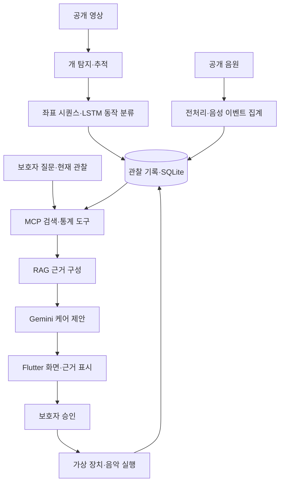

# PetMind 통합 개발 계획

작성일: 2026-10-07
중간발표 목표: 2026-10-13 화요일
최종 완료 목표: 기존 프로젝트 문서 기준 2026-11-07
기준 저장소: https://github.com/wuerphe39/capstone_really

이 문서는 대화에서 확정한 전체 개발 계획과 추가 가능한 기능 6개를 통합한 계획이다. 구현 완료 보고서가 아니며, 추가 기능은 핵심 흐름 완성 후 도입할 제안으로 구분한다.

## 1. 목표와 현재 상태

영상·음성 분석부터 개별 반려견 기록에 근거한 케어 제안, 보호자 승인, 실행 결과 확인까지 이어지는 전체 시제품을 만든다. 중간발표에서는 준비된 입력 하나가 전체 시스템을 끝까지 통과하는 모습을 보여준다.

### 지금까지 완료한 조사·검증

- 지정한 GitHub 저장소 전체 구조·코드·문서·커밋 이력을 분석했다.
- GitHub 분석 모듈의 기존 테스트 15개가 통과했으며 합성 시나리오 3개를 실행했다.
- 지속 소음의 짖음 오탐, 영상·음성 집계 시각 불일치, 잘못된 설정값 오류를 재현했다.
- 이전 로컬 PetMind에서 재사용 가능한 FastAPI·SQLite·Flutter·Gemini·장치 코드를 확인했다.
- 교수 피드백 녹음 약 15분 26초를 전체 자동 전사하고 주요 구간을 재전사했다.
- GitHub 피드백 문서에 빠진 개별 반려견 기록 기반 RAG, MCP, 카메라 제외 제안을 확인했다.
- PC에서 NVIDIA GeForce RTX 3080 12GB를 확인했다.

2026-10-11 업데이트: `petmind_integrated`에서 실제 개발을 진행했다. 분석 회귀 수정, FastAPI·SQLite·Flutter 이식, 초기 LSTM 학습, 공개 음원 평가와 공개 이미지 재생 영상 추적, 기록 검색·실제 MCP 호출, 승인·가상 장치·실패·시간초과·이력 보존을 검증했다. 추가 후보의 프로필·피드백·전후 비교·타임라인·평가 수치와 평소 비교의 표본 부족 처리도 구현했다. 전체 Python 테스트 38개와 Flutter 기능 테스트 2개가 통과했다. 실제 Gemini 답변과 실제 브라우저 시연·Pi는 아직 미검증이다. 최신 근거는 [현재 개발 상태](petmind_integrated/docs/STATUS.md)와 파트별 작업 기록을 기준으로 한다.

초기 조사 당시 구현은 Python·NumPy 기반 음성 이벤트 감지, 규칙 기반 동작 분류, PetContext와 합성 시뮬레이터였다. 지금은 초기 LSTM과 기록 검색·MCP·Gemini 어댑터를 추가했지만, LSTM의 합성 성적과 공개 입력 연결을 실제 동작 정확도로 표현하지 않는다. 실제 Gemini 기반 생성형 RAG 성공은 키 설정 이후 별도 검증한다.

### 확정 범위

| 항목 | 결정 |
|---|---|
| 개발 기준 | wuerphe39/capstone_really |
| 기존 코드 | 이전 로컬 백엔드·Flutter를 필요한 만큼 재사용 |
| 급식기 | 최종 개발 범위에서 제외 |
| 카메라·LSTM | 교수의 제외 제안을 확인했지만 사용자 선택에 따라 이번 발표에 포함 |
| LSTM 완료 기준 | 합성 궤적으로 실제 모델을 학습하고 공개 영상 입력까지 연결. 실제 동작 정확도는 미검증으로 표시 |
| RAG | 해당 반려견의 관찰·케어 기록 검색 중심 |
| MCP | 관찰 기록 검색·통계 조회 도구 연결 |
| LLM | Gemini 실제 API 사용. 키는 로컬 환경변수에 보관 |
| 장비 | PC와 Raspberry Pi 사용 가능. 센서·실제 데이터·커스텀 학습 모델은 없는 조건 |
| 기본 시연 | 공개 영상·음원과 가상 장치로 전체 흐름 검증 |

### 교수 피드백 반영

- 녹음 03:30~04:18에는 영상 동작 분석을 위한 YOLO+LSTM 설명이 있다.
- 08:17~10:48에는 개별 반려견의 로컬 DB 정보를 활용하는 RAG 설명이 있다.
- 11:07~11:43에는 MCP를 통한 로컬 데이터 접근 설명이 있다.
- 11:53 이후에는 카메라를 제외하고 음성·DB·RAG/MCP에 집중하는 대안 제안이 있다.
- 카메라·LSTM 유지 결정은 후반부 제안을 검토한 뒤 사용자가 선택한 범위다.
- 녹음 비교는 자동 전사 기반이다. 세부 표현은 오인식 가능성이 있으며, 교수의 제안과 확정된 개발 범위를 구분한다.

관련 기록: [피드백 비교 결과](feedback_analysis/피드백_비교결과.txt), [전체 전사본](feedback_analysis/feedback2_transcript.txt).

## 2. 시스템 구조와 기술 역할

| 구성 | 역할 |
|---|---|
| YOLO·추적기 | 개 위치와 연속된 추적 대상을 확보 |
| LSTM | 현재 좌표 시퀀스의 동작 패턴 분류 |
| 음성 분석 | 짖음 후보 이벤트·횟수·음량·지속시간 집계 |
| SQLite | 반려견별 관찰·제안·실행 이력 저장 및 숫자 집계 |
| RAG | 현재 질문·상태와 관련된 기록을 검색해 답변 근거 구성 |
| MCP | 기록 검색·통계 조회 기능을 도구로 연결 |
| Gemini | 관찰과 검색 근거를 종합해 설명·케어 제안 생성 |
| Flutter | 입력·분석·근거·승인·결과를 한 흐름으로 제공 |
| 가상 장치/Pi | 승인된 명령 수신·실행 상태 보고 |

주요 스택은 Python 3.12, NumPy, PyTorch, Ultralytics, FastAPI, SQLAlchemy·SQLite, 공식 MCP Python SDK, Gemini API, Flutter를 사용한다. 데이터 전처리에는 필요한 음성 입출력·리샘플링 라이브러리를 추가한다. 별도 벡터 DB는 초기 버전에 도입하지 않는다.

## 3. MVP 우선순위

### P0 — 이번 발표의 핵심

- 공개 영상에서 개 탐지·추적 및 초기 LSTM 추론.
- 공개 WAV 음원의 이벤트 분석·횟수·음량 표시.
- 반려견별 관찰 기록과 조회·통계 API.
- MCP를 통한 실제 기록 검색·집계 호출.
- 검색된 기록을 근거로 하는 Gemini 답변과 케어 제안.
- Flutter에서 입력→분석→검색 근거→제안→승인→결과 확인.
- 가상 음악 실행의 수신·완료·실패·시간초과 처리.
- 입력 출처, 모델 종류, 합성 학습 여부, 실행 모드 표시.

### P1 — 핵심 흐름 완성 후

- 추가 기능 중 간단한 반려견 프로필, 이벤트 타임라인, 평가 화면.
- Raspberry Pi에서 가상 장치 에이전트 실행 및 PC와 왕복 검증.
- 허용된 음원을 이용한 PC 실제 음악 재생.
- 보호자 피드백 저장과 케어 전후 비교.
- 실제 영상 라벨링·LSTM 평가 데이터 확충.
- 음성 이벤트의 실제 짖음 여부를 구분하는 분류기와 평가.
- 자연어 질문·검색 품질 개선.

### P2 — 최종 완성 단계

- 실제 카메라·마이크 수집과 장시간 동작 검증.
- 실제 동작 데이터로 LSTM 재학습·평가.
- 실제 반려견별 기록과 보호자 피드백 축적.
- 기록이 충분해진 뒤 평소 패턴과 비교.
- 네트워크 단절 복구와 재전송.

급식기·서보모터·로드셀·급식량 제어는 포함하지 않는다.

## 4. 핵심 구현 계획

### 4.1 실행 기반·기존 코드 재사용

- 대상 GitHub 저장소를 별도 작업 디렉터리에 준비한다. 이전 로컬 저장소는 재사용 원본으로 보존한다.
- 핵심 실행 의존성과 영상 학습 의존성을 분리하고 검증한 버전을 고정한다.
- 기존 FastAPI·SQLite·Flutter·Gemini 어댑터와 승인·실행 이력을 선별 이식한다.
- 급식 API·화면·장치 제어는 이식하지 않는다.
- 실행 스크립트, 환경변수 예제, 모델·데이터 준비 명령을 제공한다.
- 기존 모델이나 자료가 없을 때는 누락을 명확히 보고하고 공개 모델·데이터 준비 경로를 제공한다.

### 4.2 영상·LSTM

- 공개 YOLOv8n으로 개를 탐지하고 추적 ID를 유지한다. 기존 커스텀 감정 라벨 매핑은 사용하지 않는다.
- 하나의 추적 대상에서 정규화 중심 좌표와 이동량을 추출한다. 5Hz·10초 시퀀스를 기본 입력으로 한다.
- 초기 LSTM은 단일 LSTM 층과 분류기로 구성하고 정지·이동·회전 궤적·왕복 궤적 4종을 학습한다.
- 기존 시뮬레이터를 확장해 속도·크기·잡음·시작점을 다양화한다. 학습·검증·테스트는 서로 다른 생성 시드와 궤적 단위로 분리한다.
- 관찰 부족·추적 단절은 unknown으로 처리한다. 자세 모델이 없는 초기 버전에서는 앉았다 일어남 분류를 제공하지 않는다.
- 합성 데이터 평가와 공개 영상 연결 검증을 별도 기록한다. 공개 영상 결과를 실제 동작 정확도로 발표하지 않는다.
- 카메라 이동의 영향을 기록하고, 움직이는 카메라 영상의 좌표 변화를 반려견 동작만으로 해석하지 않는다.

### 4.3 음성·상태 집계

- 기존 BarkDetector를 유지하면서 지속 소음 종료 전 재감지를 억제하고 설정값을 검증한다.
- WAV 입력을 모노·16kHz로 변환하며 음량 단위는 dBFS로 유지한다.
- 공개 개 소리와 비짖음 대조 음원을 고정 목록으로 준비하고 출처·라이선스·파일 해시를 기록한다.
- 에너지 기반 결과는 실제 짖음 분류가 검증되기 전까지 '짖음 후보 이벤트'로 표시한다.
- 영상·음성은 같은 세션 시간축으로 집계한다. 오래된 관찰을 현재 구간에 포함하지 않는다.
- 서로 다른 공개 영상·음원을 결합하면 합성 시나리오임을 표시한다.

### 4.4 SQLite·RAG·MCP·Gemini

- 관찰 기록에 반려견 ID, 세션, 관찰 시각, 입력 출처, 동작·음성 요약을 저장한다. 제안·실행·보호자 피드백은 관련 관찰과 연결한다.
- 발표용 가상 반려견 이력을 재현 가능한 시드 데이터로 제공하고 실제 기록과 구분한다.
- 초기 검색은 반려견·기간 필터와 관찰 라벨·요약 텍스트 관련도를 사용한다. SQLite·Python 기반으로 시작한다.
- 숫자·기간별 통계는 SQL로 계산하고 관련 기록 최대 5건과 통계를 Gemini에 전달한다.
- 공식 MCP Python SDK로 로컬 stdio 서버를 구성한다. 백엔드 MCP 클라이언트가 search_observations, get_observation_stats, get_care_history를 실제 호출한다.
- 도구는 반려견·기간·조회 수를 입력받는 읽기 전용 도구로 만든다. 검색 실패와 빈 검색 결과를 구분한다.
- Gemini는 현재 관찰·검색 결과·통계를 받아 구조화된 설명, 근거, 기록 ID, 제안 액션을 생성한다.
- 존재하지 않는 기록 인용은 허용하지 않는다. 관련 기록이 없으면 근거 부족을 표시한다.
- 키 누락·시간초과·응답 검증 실패 시 규칙 제공자로 전환하고 실제 제공자를 표시한다. 폴백을 Gemini 검증 성공으로 계산하지 않는다.
- 유사 과거 사례·케어 이력 검색은 교수 피드백의 취지를 구체화한 구현 방향이며, 일반 케어 지식 검색은 후속 보조 기능으로 둔다.

### 4.5 주요 인터페이스

| 인터페이스 | 역할 |
|---|---|
| POST /observations | 분석된 관찰 기록 저장 |
| GET /observations | 반려견·기간별 기록 조회 |
| POST /care/evaluate | 관찰 ID와 질문으로 검색·평가 실행 |
| /care/latest, /care/history | 제안과 검색 근거 조회 |
| /care/{id}/approve, /dismiss | 보호자 결정 |
| /care/actions/* | 실행 결과·장치 응답 |

### 4.6 화면·승인·가상 장치

- 기존 Flutter 화면에 입력 미리보기, 동작 궤적, 음성 이벤트, 검색 근거 기록, Gemini 제안을 연결한다.
- 수집 데이터가 없을 때 정상 상태로 표시하지 않는다.
- 승인 전에 실행하지 않으며 액션을 DB에 먼저 저장한 뒤 명령을 발행한다.
- 가상 장치는 명령 ID 중복 실행을 막고 수신·완료·실패를 보고한다. 종료 상태가 늦은 응답으로 되돌아가지 않도록 한다.
- 기본 시연은 PC의 가상 장치로 완료하고 Pi 연결·실제 음악 재생은 P1으로 추가한다.

## 5. 추가 가능한 기능 6개

아래 기능은 전체 계획에 통합한 확장 후보다. 핵심 P0의 완료를 우선하며, 이번 발표에 넣는 간단한 버전도 전체 연결 이후에 추가한다. 모든 후보를 동시에 구현하는 일정은 아니다.

| 추가 항목 | 기능·효과 | 최소 구현 범위 | 권장 시점 | 추가 예상 시간 |
|---|---|---|---|---|
| 반려견 프로필·보호자 메모 | 해당 반려견의 상황을 검색·설명에 반영 | 이름·나이·생활 패턴·관찰 특이사항 저장. 보호자 입력임을 표시 | P0 완료 후, 이번 발표에 가능하면 포함 | 1~2시간 |
| 이벤트 타임라인 | 전체 시스템 연결을 시간순으로 보여줌 | 관찰·제안·승인·실행 이벤트를 같은 세션으로 묶어 표시 | 발표용 추가 기능 1순위 | 2~3시간 |
| 보호자 피드백 | 오탐 평가와 향후 개선 자료 확보 | 관찰/제안에 '실제 짖음 여부', '제안 적절성', 메모 저장 | 발표 후 | 2~3시간 |
| 평소 패턴과 비교 | 현재 관찰이 평소와 얼마나 다른지 설명 | 충분한 기록이 있는 동일 시간대의 빈도·활동 분포 비교 | 실제 기록 축적 후 | 3~5시간 + 기록 수집 기간 |
| 케어 전후 비교 | 실행 후 관찰 변화 확인 | 음악 실행 전후 동일 길이 구간의 음성·움직임 요약 비교 | 발표 후 | 2~4시간 |
| 평가 대시보드 | 진행도를 숫자·사례로 설명 | 처리 시간, 처리 건수, 검색 근거, 오류·실행 상태 표시 | 발표용 추가 기능 2순위 | 2~3시간 |

### 추가 기능 적용 원칙

- 프로필·메모는 보호자 제공 정보이며 측정 결과와 구분한다. 프로필만으로 상태를 단정하지 않는다.
- 타임라인은 이미 저장한 관찰·제안·액션 기록을 활용하고 중복 저장을 최소화한다.
- 보호자 피드백은 자동 학습 정답으로 곧바로 사용하지 않고 검토 가능한 기록으로 보관한다.
- 평소 패턴 비교는 비교 기간과 표본 수를 함께 표시한다. 기록이 부족하면 비교 불가로 표시한다.
- 케어 전후 변화가 음악 때문에 발생했다고 단정하지 않는다. 측정된 변화와 인과 효과를 구분한다.
- 평가 화면은 실제 처리 결과를 집계한다. 합성 데이터의 모델 평가와 실제 입력의 운영 지표를 나눈다.

추가 개발 순서는 이벤트 타임라인 → 간단한 평가 화면 → 최소 프로필·메모 → 보호자 피드백 → 케어 전후 비교 → 평소 패턴 비교를 권장한다. 마지막 항목은 충분한 기록이 확보된 뒤 수행한다.

## 6. 작업 순서와 예상 일정

전체 연결을 먼저 만들고 분석기를 교체하는 순서로 진행한다. UI나 모델 하나를 끝까지 고도화한 뒤 통합하지 않는다.

| 순서 | 작업 | 난이도 | 예상 시간 | 완료 증거 |
|---|---|---|---:|---|
| 1 | 저장소·환경 정리, 기존 분석 오류 수정 | 중간 | 3~4시간 | 기존 테스트와 회귀 테스트 통과 |
| 2 | 백엔드·DB·Flutter 이식, 합성 관찰 전체 연결 | 중간 | 4~5시간 | 입력→제안→승인→가상 실행 |
| 3 | 기록 검색·MCP·Gemini 연결 | 중상 | 4~6시간 | 실제 도구 호출과 기록에 근거한 답변 |
| 4 | 공개 음원 입력·분석·시각화 | 중간 | 2~3시간 | 실제 음원과 감지 결과 비교 |
| 5 | 초기 LSTM 학습·평가·공개 영상 추적 연결 | 중상 | 5~7시간 | 학습 모델, 평가 결과, 영상 입력 추론 |
| 6 | 통합 상태·장애 처리·화면 마무리 | 중간 | 3~4시간 | 실패·근거 부족·중복 승인 시나리오 |
| 7 | 연속 시연·기록·발표 자료 | 중간 | 3~4시간 | 시연 영상과 기능별 검증표 |

핵심 계획은 총 24~33시간 예상이다. 이전 17~24시간 추정에는 LSTM·RAG·MCP가 포함되지 않았다.

발표용 추가 후보인 타임라인·간단한 평가 화면·최소 프로필을 모두 포함하면 5~8시간이 더 필요해 총 29~41시간으로 본다. 기존 화면과 로그 재사용 정도에 따라 달라지며, 개발 시간은 1인 집중 작업 기준 추정치다.

- 10월 8~9일: 가능하면 실행 기반과 통합 골격을 먼저 준비한다.
- 10월 10~11일: 분석·검색·Gemini·화면을 연결하고 전체 시연을 확보한다.
- 10월 12일: 통합 오류 수정·회귀 검증·발표 준비에 집중한다.
- 10월 13일: 검증된 범위로 중간발표를 진행한다.

주말만 16~20시간 확보된다면 모든 항목의 안정화는 빠듯하다. 일정이 부족하면 추가 기능·Pi 실연동·실제 음악·화면 장식을 미룬다. 합의한 LSTM·RAG·MCP는 조용히 제외하지 않고, 구현 또는 검증에 실패하면 해당 항목을 미완료로 기록한다.

## 7. 검증과 완료 기준

각 작업은 원인 확인 → 최소 변경 → 관련 테스트 → 결과 기록으로 마무리한다.

### 필수 테스트

- 기존 15개 테스트와 지속 소음·시간축·잘못된 설정 회귀 테스트.
- 추적 단절·관찰 부족·반려견 미탐지의 unknown 처리.
- LSTM 학습 데이터 분리, 저장 모델 재로딩, 합성 평가 결과 재현.
- 공개 음원에서 감지·오탐·미탐 사례 기록.
- 다른 반려견 기록의 검색 혼입 방지, 검색 없음·도구 실패 구분.
- MCP 도구의 실제 호출과 반환값 검증.
- 실제 Gemini 응답 1건 이상, 인용 기록 검증, API 오류 폴백.
- 승인 전 미실행, 중복 승인·중복 명령, 장치 실패·무응답 처리.
- 3개 시나리오를 재시작 없이 반복하고 서버 재시작 후 이력 보존.

### 추가 기능 도입 시 검증

- 타임라인의 이벤트 순서·세션 연결·중복 표시 여부.
- 평가 화면 수치와 원본 기록의 일치 여부.
- 프로필·메모 변경이 다른 반려견에게 적용되지 않는지 확인.
- 피드백이 원래 관찰·제안과 올바르게 연결되는지 확인.
- 전후 비교의 시간 길이와 데이터 누락 처리 확인.
- 기준선 표본이 부족할 때 정상·이상으로 단정하지 않는지 확인.

이번 MVP의 완료는 LSTM·음성 분석·기록 검색·MCP·Gemini·Flutter·가상 장치가 실제로 연결되고, 입력 하나가 끝까지 처리되는 상태다. 실제 반려견 환경의 정확도와 케어 효과 검증은 이후 단계다.

## 8. 중간발표 결과물과 작업 기록

### 발표 결과물

1. 공개 영상·음원에서 관찰 결과가 생성되는 화면.
2. 초기 LSTM의 학습·평가 결과와 한계.
3. 같은 질문에도 반려견 기록에 따라 달라지는 검색 결과와 답변.
4. MCP 도구 호출 → 검색 기록 → Gemini 답변의 연결 증거.
5. 보호자 승인 → 가상 장치 완료 → 이력 저장.
6. 입력부터 끝까지 이어지는 3~5분 시연 영상.
7. 여유가 있으면 이벤트 타임라인·평가 화면으로 전체 진행 상태 표시.

발표 원고에는 프로젝트 목적, 해결하려는 문제, 전체 구조, 사용 기술, LSTM/RAG/MCP의 역할, 구현 기능, 이번 변경, 시연 가능 범위, 미완료 항목, 향후 일정을 포함한다. 진행률은 근거 없는 백분율보다 완료된 흐름과 검증 항목으로 제시한다.

### 작업 단위별 기록

- 수정한 파일과 수정 이유.
- 해결한 문제와 추가한 기능.
- 실행·테스트 명령과 결과.
- 남아 있는 문제와 다음 작업.
- 데이터·모델 출처, 준비 방법, 학습 조건, 검증 범위.

변경 기록은 구현이 끝난 사실과 계획을 구분한다. 공개 입력, 합성 이력, 가상 장치 결과를 실제 장기 관찰·실장비 실행으로 표현하지 않는다.

## 9. 발표 이후 개발 방향

- 10월 14~18일: 중간발표 피드백 반영, 실제 영상 라벨링·음성 평가, 보호자 피드백 기록.
- 10월 19~25일: 실제 데이터 기반 LSTM 개선, 카메라·마이크 및 Pi 연동. 장비 확보 여부를 반영한다.
- 10월 26일~11월 1일: 실제 반려견별 기록 축적, 장애 복구·장시간 실행 검증, 케어 전후 관찰.
- 11월 2~5일: 모델·시스템 평가와 최종 발표 준비.
- 11월 6~7일: 신규 기능보다 치명적 오류 수정과 시연 리허설에 집중.

평소 패턴 비교는 기록량이 충분할 때 추가한다. 데이터·장비 확보가 늦어지면 가상 검증 범위와 실제 검증 범위를 명시하고 일정을 조정한다.

## 10. 참고 자료

- [기준 GitHub 저장소](https://github.com/wuerphe39/capstone_really)
- [Ultralytics 추적 기능](https://docs.ultralytics.com/modes/track/)
- [YOLOv8 모델](https://docs.ultralytics.com/models/yolov8/)
- [MCP 공식 Python SDK](https://github.com/modelcontextprotocol/python-sdk)
- [Gemini 구조화 출력](https://ai.google.dev/gemini-api/docs/structured-output)
- [ESC-50 공개 음원](https://github.com/karolpiczak/ESC-50)
- [DAVIS 공개 영상 데이터](https://davischallenge.org/davis2017/code.html)

공개 데이터와 모델은 도입 시 배포 조건과 개별 파일 출처를 확인한다. 위 링크는 후보·공식 문서이며 다운로드나 실제 분석 완료를 의미하지 않는다.
# 2026-10-11 실제 개발 반영 — 공개 데이터·LSTM·RAG

최신 작업 폴더는 `petmind_integrated`다. 자세한 변경과 실행 증거는 `docs/22_공개_모션데이터_검증.md`, `docs/23_LSTM_특징_불확실성_개선.md`, `docs/24_RAG_기간_의미검색_개선.md`에 저장했다.

- 공식 SIGGRAPH 개 모션 캡처 51개 파일을 확보하고 FPS·프레임·해시·촬영 그룹을 검사했다. 195/12/13 구간으로 분리해 실제 궤적 사전학습에 사용했다. 행동 라벨은 임의 생성하지 않았다.
- LSTM 특징 4→8개, 저확신·좌표 급변 unknown, 구버전 호환과 백업, 출처·버전 표시를 구현했다. 실제 모션 테스트에서는 단순 속도 유지 기준보다 오차가 9.6% 높았으므로 실제 성능 개선으로 주장하지 않는다. 실제 행동 분류 정답은 아직 없다.
- RAG 한국 시간 기간 해석, 보호자 메모·케어 근거, 실제 Gemini 임베딩 검색·캐시·명시적 폴백을 구현했다. 자체 20질문 Recall@5 25%→100%, Top-1 60%이며 실제 사용자 전체 성능이 아니다.
- 실제 embedding→MCP→Gemini→인용 통합 성공. Python 52개, Flutter 2개 테스트와 analyze·웹 release 빌드 통과. 모델과 검색을 로컬 실행 서버에 적용했다.
- 다음 우선순위: 실제 고정 카메라 라벨 데이터, 반려견/촬영 독립 평가, 실제 보호자 질문 평가, Pi 카메라·마이크·물리 재생 검증, 브라우저 연속 시연 녹화. 급식기는 제외한다.

# 2026-10-11 실제 성능 측정 추가

`petmind_integrated/docs/25_실제데이터_성능비교.md`에 공식 TigDog 라벨·원본 영상 평가를 기록했다. 시간·라벨·개체 조건을 통과한 이동 구간 9개에서 v1/v2 재현율 모두 44.4%였다. 5개는 추적/시간 연속성 문제로 unknown이며 실제 향상은 입증되지 않았다. 비이동 정답이 없어 전체 정확도를 계산하지 않는다. 실제 좌표 예측 보조 비교에서도 v2 오차가 약 0.98% 더 컸다. 모델은 유지했고 테스트 자료로 튜닝하지 않았다. 현재 Python 55개 테스트 통과. 다음 작업은 추적 실패·카메라 이동 영향 개선 및 실내 4종 독립 정답 확보다.

# 2026-10-11 InterPet4D 적용과 평가

사용자 선택에 따라 영상 데이터에 집중했다. `petmind_integrated/docs/27_InterPet4D_적용_평가.md`에 실제 225개 자세 파일 적용, 반려견 분리 89/14/21 구간, 후보 학습 및 평가를 기록했다. 좌표 예측 MSE는 기존 v2보다 12.84% 감소했지만, 실제 영상의 이동 재현율은 44.4%→0%로 악화해 후보를 기본 모델로 채택하지 않았다. 원본 테스트 영상 2개에서 검출된 개가 다른 ID로 잡힌 뒤 기존 선택 ID에 이어지지 않는 문제가 확인됐다. 현재 Python 테스트 57개 통과. 다음 우선순위는 추적 ID 재획득, 카메라 이동 영향, 실제 행동 시간 라벨이다.
